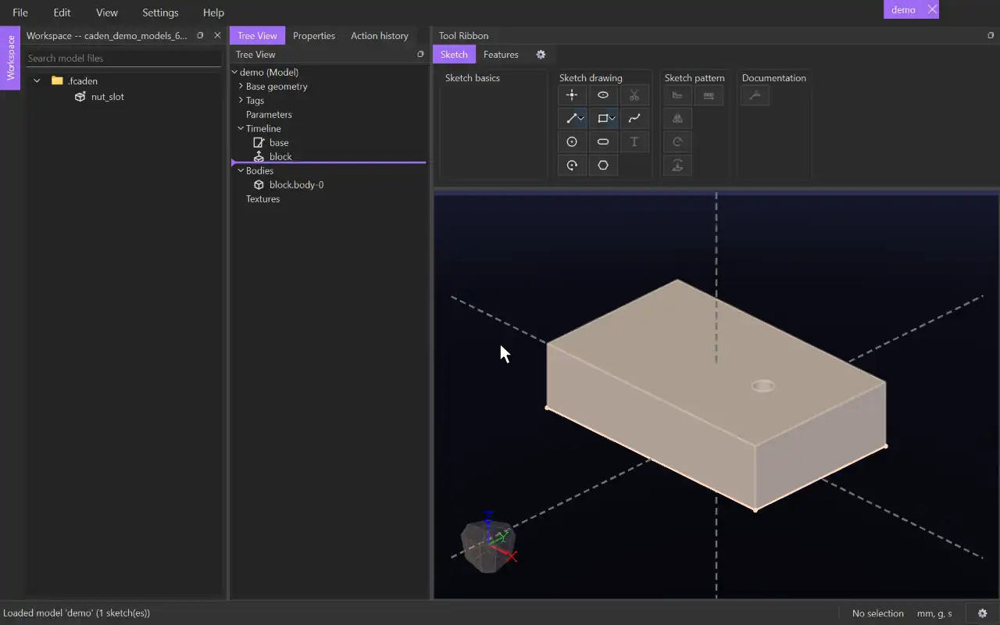

# Custom features

A custom feature is a set of sketches and features you draw once and use in any model, as one tool. It lives in its own file, `<name>.fcaden.py`, inside a workspace.

## Making one
1. Open a workspace. Then choose **File › New Custom Feature**, click **New Custom Feature** on the welcome page, or right-click a folder in the Workspace panel and choose **New Custom Feature**. The file goes in the workspace's `.fcaden` folder, which is made if it isn't there.
2. Draw the feature as you would in any model, together with whatever it is drawn on.
3. Put the values a user should set in a parameter group named `feature_inputs`, and use them in the sketch and the features.
4. Click **Feature Definition** in the **Custom Feature** bag. Pick the sketches and features that make up the custom feature, click **Next**, and name each input. See [Feature Definition](../tools/feature_definition.md).
5. Save the file.

Without a workspace, a custom feature file can still be made, drawn and defined. Using one needs a workspace, or installing it (below).

## Where they are kept
- Files directly in `.fcaden` are tools in a bag named `.fcaden`.
- Each subfolder of `.fcaden` is a bag named exactly after the folder. Subfolders of subfolders are not used.
- The bags appear on the **Features** tab when the workspace opens. Right-click a bag to make a new custom feature in it, or to hide the bag. The Tool Ribbon Editor puts a hidden bag back.
- A custom feature saved outside `.fcaden` isn't in any bag, so CADen asks before saving it there.

## Installing one
Install a custom feature to have it in every model you open, with or without a workspace.

- **File › Install Custom Feature...** copies the `.fcaden.py` files you pick into your own custom features folder. Each one is a tool in the `.fcaden` bag.
- **File › Install Custom Feature Bag...** copies a folder's `.fcaden.py` files as a bag of their own, named as the folder is.
- Installing something that is already installed asks whether to replace it.
- Your folder works like a workspace's `.fcaden` folder. A bag with the same name in both shows as one bag. A tool in both shows twice, and the installed one's tooltip says so.
- A model refers to an installed custom feature by its installed name, such as `installed:nut_slot.fcaden.py`, so the model works on any computer that has it installed.
- Right-click an installed tool and choose **Uninstall** to remove it, or right-click an installed bag and choose **Uninstall Bag**. CADen asks first.

## Using one

1. Click its tool in its bag. The Properties panel shows a box for each input, a value box for each feature input, and **Flip** if the feature has a direction. A file with no Feature Definition yet says so there, with a button to open it.
2. Click a box, then click what it stands for in the model. A pick of the wrong kind, or one that lies the wrong way against the sketch plane, is refused, with the reason.
3. Change the values if you want to. Each starts at the file's default. Once every input is picked, the model shows the result as a preview, and it follows each change you make.
4. Click **Create** to keep it. **Cancel** or Escape takes the preview away. The custom feature is one item in the tree. What it builds is never shown separately.

- **Flip** builds the feature on the other side of its sketch plane, so a cut goes the other way.
- A cut in the custom feature (Cut Extrude, Rotate Cut, Swept Cut) also needs the bodies it cuts. That is an input of its own, named in the Feature Definition like the others. Where it is used, **Auto select bodies** is ticked when the file's cut had it; untick it and click a face of each body to cut (click again to drop one). Cuts that take the same bodies share one input.
- A feature drawn on a circle's plane (a slot round a hole) is turned about the circle to fit what you pick: if the file's stop face was on the hole's right and you pick an edge on its left, the slot runs left.
- Select it in the tree to see the sketches it draws (they are hidden otherwise).
- Right-click it in the tree to **Edit Custom Feature** or open its file. Delete removes it.

## Live links
- The custom feature follows what it was given: move the hole, and the slot moves with it.
- Edit the custom feature's file and save it, and every model using it updates.
- If what it uses can't be found any more, it turns red in the tree with the reason, and builds nothing until it is fixed.
- Deleting something it uses warns first and lists it, as for any other feature.

## Example: an embedded nut slot
A hexagon pocket that holds a nut so it can't turn, with a channel for sliding the nut in from the side.

- **Hole Arc** — the edge of the screw hole on the face. It places the hexagon and sets the sketch plane.
- **Stop Face** — a face square to that one. The hexagon's two parallel flats run out to it, making the channel.
- **cut_depth**, **offset_from_sketch** and **across_flats** — the feature inputs: how deep the pocket goes, how far below the face it starts, and the nut's size across its flats (7/16 in for a 1/4-20 nut).

[← All documentation](../index.md)
