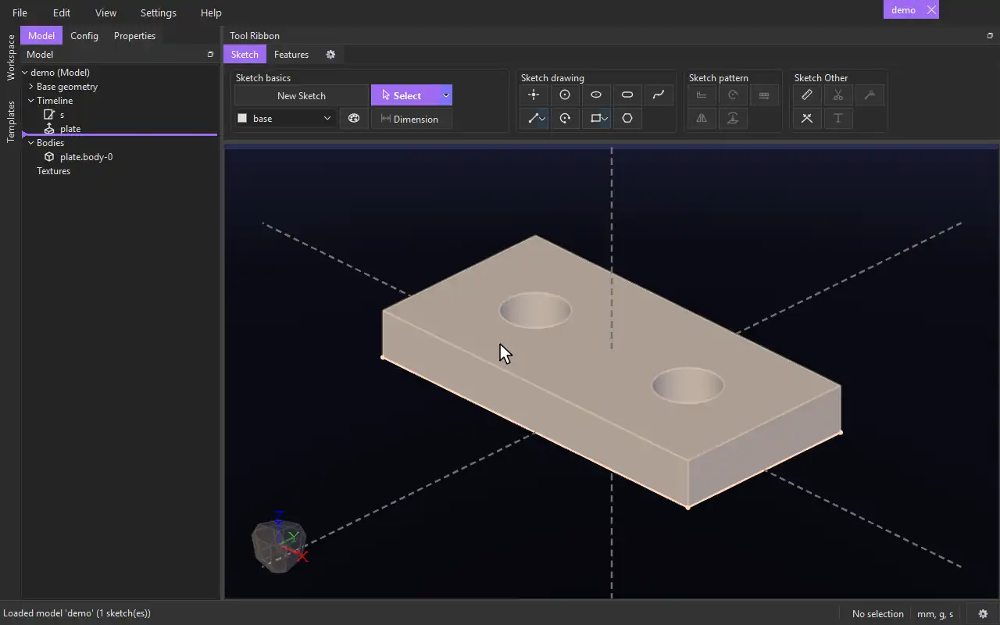

# Importing a model

Bring a whole model into the one you are working on: its bodies, to build on like your own, and its sketches, planes and vectors to build from. The model stays linked: change it and save it, and every model importing it follows.

## Importing

1. **File › Import › Model...** (next to **Parameters from Model...**), or the **Import Model** tool (Features tab › 3D Advanced), and choose the model file. Or right-click a model file in the Workspace panel › **Import Model**: it comes into the model in front (**Import Parameters** there brings only its parameters; with an assembly in front the item is **Insert Model**).
2. The import options:
   - **Manually place model** (ticked): place it with assembly constraints (below). Unticked, it goes exactly where it is in its own file -- its origin on this model's origin, turned the same way.
   - **Import parameters as well** (ticked): its parameters come in too, as **Parameters from Model** brings them (as `<model>::<name>`). Already imported from that file, they are kept as they are.
3. Placed manually, the **Model Import** form opens in the Properties panel.

The import is one item on the timeline, named after the model (`bolt`, then `bolt_2`, ...). Rename it like any item.

## Placing it

The Model Import form lists its constraints on top, and the constraint tools under them -- the same ones an assembly has: **Coincident**, **Parallel**, **Concentric**, **Between**, **Geared** and **Rack and Pinion**.

1. Click a tool. Its form opens: click one face of the imported model and one of your model (a face, a base or reference plane, or a face of a model imported earlier). The imported model moves to show it.
2. Click **Create**: you are back at the Model Import form, the new constraint on its list. Add as many as you like -- it doesn't have to be fully placed.
3. While the form is open, drag the imported model with the left mouse button to move it, or with the right button to turn it, as far as its constraints let it.
4. Click **Done**. The model is fixed where it stands: it can't be moved or turned any more, even if it isn't fully constrained.

To change it later, right-click it on the timeline › **Edit Feature** (or double-click it): the form opens again, with its constraints. Select one and **Edit** or **Remove** it, or add more. **Cancel** puts everything back.

## What it brings

- **Bodies**, named `<import>.<body>` (`bolt.shaft.body-0`). They are bodies like any other: sketch on their faces, cut them, fillet them, join them to yours. These edits are this model's: the imported model's file never changes. Bodies hidden in the model come in hidden.
- **Sketches, planes and vectors**, listed under the import in the timeline -- hidden at first: right-click one › **Show**. They are for reference: extrude a region of an imported sketch, start a sketch on an imported plane (right-click › **New Sketch**), project its curves. They can't be edited here -- open the model to change them.
- A model in other units comes in at its real size. A model that imports models itself brings those too.

## When the model changes

- Save the imported model (here or in any program) and every open model importing it updates: its bodies, sketches and planes come in again, and its constraints are met again -- the import moves only if the new geometry needs it. Models that aren't open pick the change up when they are opened.
- Something you built on a face or edge that is no longer there shows its error, as when an earlier feature of your own changes.
- If the model's file can't be found when you open yours, the import brings nothing and is marked **file not found**; CADen offers to locate it (also on the import's right-click menu: **Locate Model...**).
- Each model keeps a note of the models importing it (and they of it), so the link holds both ways. Before your model is first saved the import names the file by its full path; saving makes it relative to your model, so the two can move together.

## See also

- [Insert Model](../tools/insert_model.md) -- placing models in an assembly, with the same constraints.
- [Coincident](../tools/mate_coincident.md), [Concentric](../tools/mate_concentric.md) and the other constraints.

[← All documentation](../index.md)
