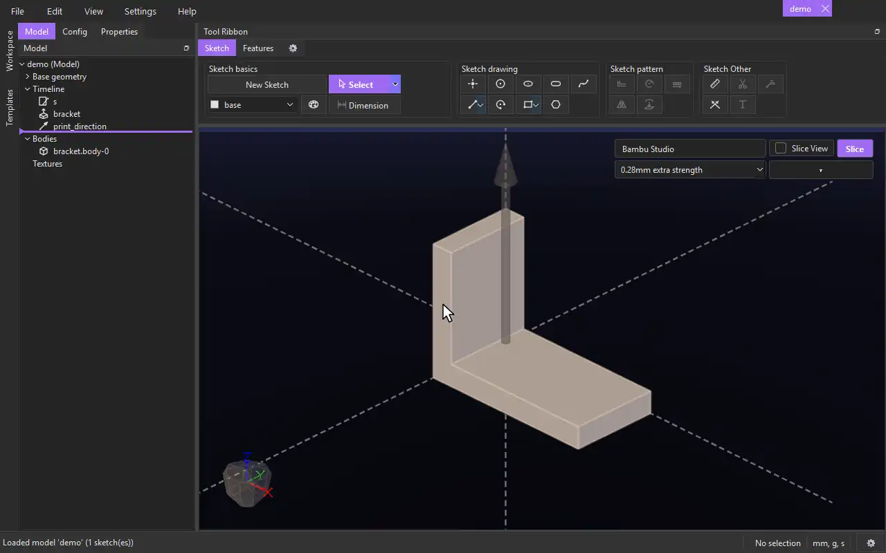

# Slicing from CADen

See each body's estimated print weight and print time from your slicer, without leaving CADen. Works with **Bambu Studio** and **Orca Slicer**. The slicer keeps all the print settings: CADen uses the printer and filament selected in it, and its print presets.

## Turning it on

- **View › 3D Print Overlay** puts the overlay over the top-right corner of the model view, for the model that is shown. The choice is saved in the model file.
- The overlay is also a setting, **print.slice_overlay** (off by default). Turn it on in **Settings** to have it on every model that doesn't say otherwise. A model's own choice, from View › 3D Print Overlay, wins over the Settings one.
- Models made from the **3D Print** master file have it on already.
- The first time the overlay shows, CADen connects to your slicer by itself: the one that is running, or else an installed one. **File › Connect** looks again (for example, after you install one).
- If no slicer is found, the overlay is just a **Connect** button.

## The overlay

- **First row:** the slicer, **Slice View**, and **Slice**. With both Bambu Studio and Orca Slicer installed, the slicer is a dropdown to choose between them.
- **Second row:** the **print preset**, and beside it the wide arrow button that opens and closes the results. The print preset dropdown lists the slicer's print (process) presets for the printer selected in it, your own first. It starts on the one selected in the slicer. If you pick another, that model keeps it (saved in the model file); pick the slicer's own again to follow the slicer.

## Slicing

1. In your slicer, pick the printer and filament you want.
2. In CADen, choose the print preset, then click **Slice**. The results open below.
3. Each body is sliced on its own. The panel shows the slicer and its presets on top, then a row per body with its **weight** and **print time**, and a total.

## Slice View

After a Slice, tick **Slice View** (beside Slice) to see the printed tool paths:

- The bodies turn see-through, and each body's tool paths are drawn over it in its own colour, shaded like the slicer's own preview: each path is drawn at its real line width and layer height, so every layer shows as its own ridge. Only the extruded paths are shown, not travel moves, the purge line or the skirt.
- A slider with two handles appears on the right side of the view. Drag the handles to show only the layers between them; each handle is labelled with its layer number and height.
- Changing the model, the print preset or the slicer turns Slice View off until you Slice again.

## What is sliced

- Each body as **File › Export STL** would write it, at the export accuracy and with any [Infill](../tools/infill.md) cavities in it.
- If the model has a vector named **print_direction** (the 3D Print master has one), each body is turned so that vector points up. Otherwise it is sliced standing as modelled.
- The slicer then places it on its plate as usual.

## Good to know

- When you save a new print preset in the slicer, or change one, the print preset list updates by itself a moment later. Each Slice reads the presets as they are then.
- Each Slice reads the printer and filament selected in the slicer at that moment. A setting you changed in the slicer but did not save into a preset is not used: save the preset first.
- After you change the model, the print preset or the slicer, the last results stay but are greyed with **Out of date -- Slice again**.
- If a body can't be sliced (for example, it is too big for the printer's plate), its row says why. The other bodies are still sliced.
- Slicing runs in the background. Each body takes a few seconds.

[← All documentation](../index.md)
