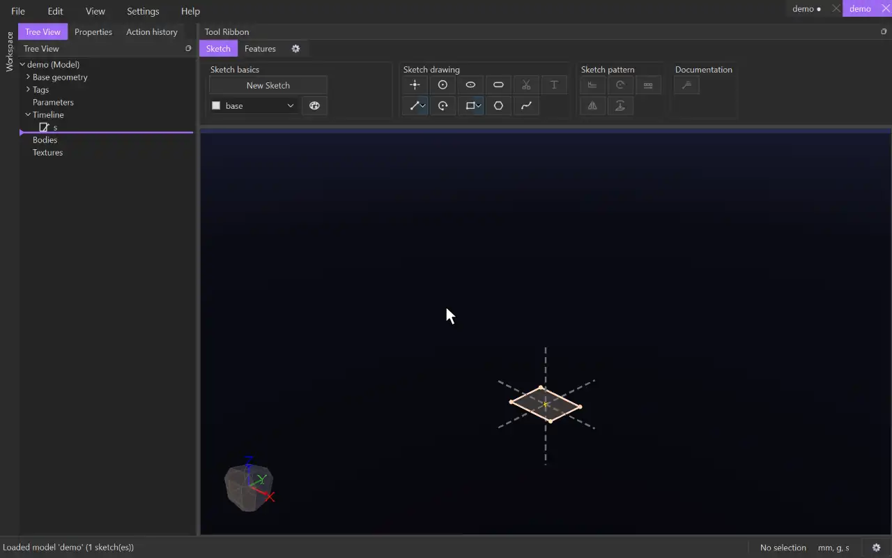
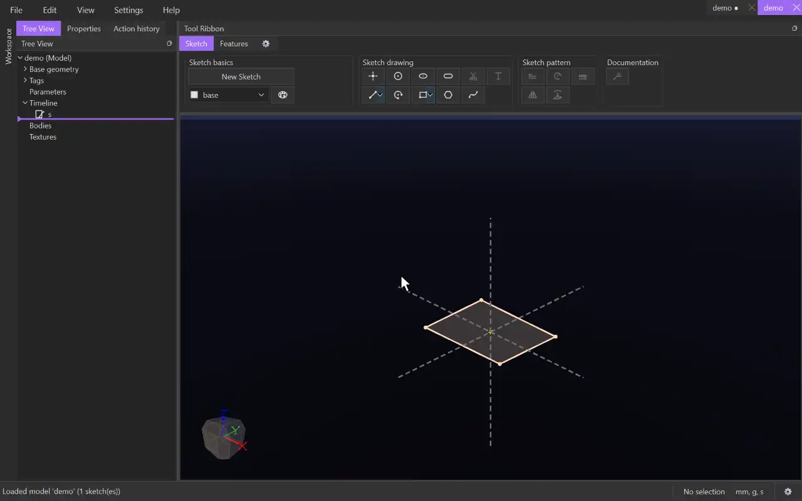
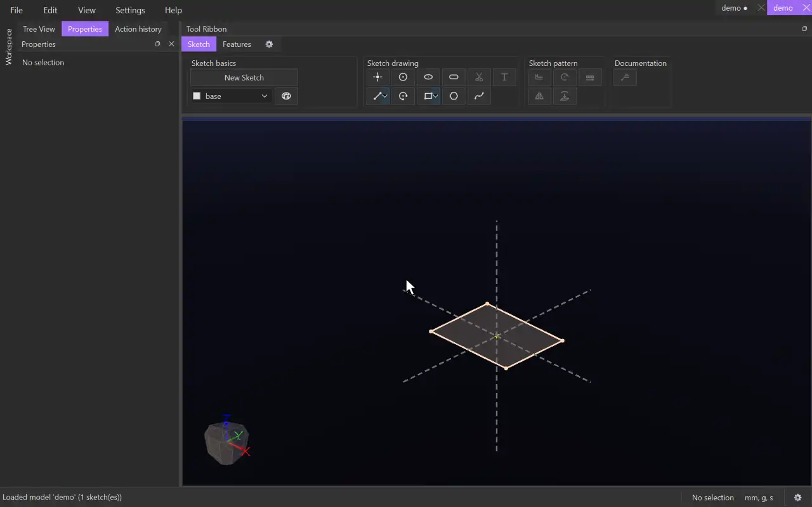

# Values and expressions

Every box that takes a number -- a distance, an angle, a dimension, a parameter -- takes an
expression: units, arithmetic, functions and the model's parameters. A mark beside the box says
whether it reads: a blue dot while you type, then a green check, or a red cross with the reason.

## Mixed units

Write a number with a unit and CADen converts it to the model's unit: `8mm + 10in` is
262 mm. A number without a unit is in the model's unit. Units that work include `mm`, `cm`,
`m`, `in` and `ft`; angles are in degrees.

- Arithmetic: `+ - * /`, `^` for powers, and brackets: `(40mm - 2 * 3mm) / 2`.
- Functions: `sqrt`, `sin`, `cos`, `tan`, `abs`, `min`, `max`, `round`, `floor`, `ceil` and
  more -- the value editor lists them as you type.
- A box checks the kind of value it needs: a distance must come out as a length.

## Parameters

A parameter is a named value the whole model can use. Right-click **Parameters** in the tree
and choose **Add parameter**, then give it a name (`box_height`) and a value (`20mm`) in the
Properties panel.

Use its name in any value: `box_height + 1in`. Change the parameter and everything that uses it
updates. Parameters can be grouped: a parameter in a group is written `group::name`.

## The value editor

The arrows at the right of a value box open the value editor: a bigger box for long
expressions. As you type it suggests parameters, functions and units; the list on the right
inserts a parameter at the cursor. The check above the box says whether the expression reads,
and why not when it doesn't. **Help** in the editor opens this page.

Back to the [documentation](../index.md).
