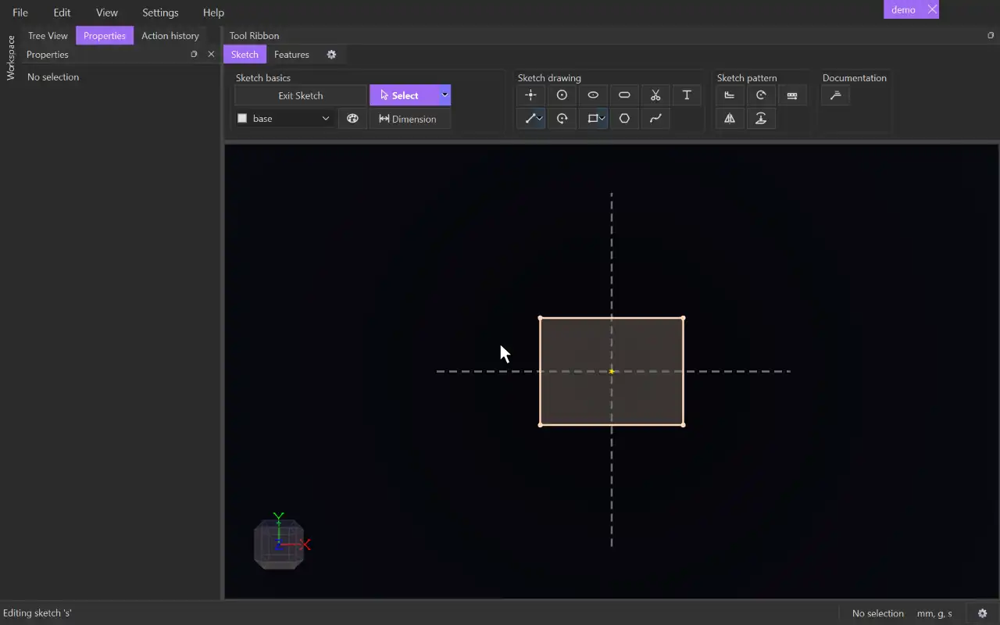

# Annotation

{.tool-demo}

Pins a text note to a point in a sketch. The note has a leader line from the point to an underline, with your text above it.

**Where:** Sketch tab › Documentation · **Shortcut:** Shift+A (while editing a sketch)

## How to use
1. Edit a sketch and click **Annotation**.
2. Click where the note should point. The point snaps like the Point tool. On a curve, it stays attached to that curve.
3. Move the mouse to place the text. Press **R** while placing to make the underline run vertically instead of horizontally.
4. Click again to drop the note. The Properties panel shows it with the **Text** box ready for typing.
5. Type the note. It updates as you type and can span several lines.

## Options
- **Text** — what the note says. A note left empty is kept and shows "...".
- **Vertical (underline along the sketch's vertical axis)** — runs the underline vertically instead of horizontally.
- **Text size** — ticked **Model's size** uses the model's default text height. Untick it to type a size for this note, e.g. `3mm` or an expression.

## Tips
- Notes show only while their sketch is being edited, like dimensions.
- The text has a real size in the model, so it gets bigger on screen as you zoom in.
- The underline runs away from the point: to the right when the text is placed to the right, and so on.
- Escape while placing removes the half-placed note, and the point it created if nothing else uses it.
- Double-click a note's text to edit it again in the Properties panel. Drag the text to move it.
- The point a note pins to is ordinary geometry: you can drag it, constrain it or dimension it.
- The default text height is a model setting: 5 of the model's length unit to start with. Change it with the gear button beside the units in the status bar.
- Each visit to the Text box is one undo step.

## See also
- [Project](project.md) — bring outside geometry in to annotate.
- [Pattern](pattern.md) — another tool on the Sketch tab.

[← Documentation](../bags/documentation.md) · [All documentation](../index.md)
