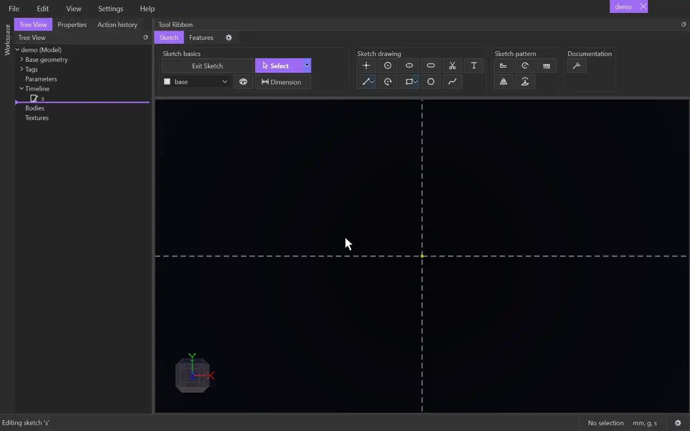

# Arc

{.tool-demo}

Draws a circular arc from its centre, a start point and an end point.

**Where:** Sketch tab › Sketch drawing · **Shortcut:** A

## How to use
1. Click **Arc**. If you aren't in a sketch yet, click a plane or flat face first to start one.
2. Click to place the centre.
3. Click to place the start point. This sets the radius.
4. Move the cursor around the centre. The preview fills the arc counter-clockwise from the start.
5. Right-click to fill the other way round if you want.
6. Click to place the end point. The tool stays active for the next arc.

## Tips
- The end point always lands on the arc's own circle. Only the cursor's direction from the centre counts. If a point or crossing on that circle is in snap range, the end snaps to it.
- The centre and start snap like any point. Snapping them onto existing geometry adds the matching constraint.
- Escape part-way cancels the arc and removes the points it placed, unless something else already uses them. A second Escape returns to [Select](select.md).
- Rest the cursor near an arc for a moment and a dashed guide continues its circle past the ends. You can snap to that guide.
- Use [Dimension](dimension.md) on an arc to set its diameter. Select an arc and a line to make them tangent (Shift+T).
- Select an arc and a circle, another arc, or a round edge of a body, then choose **Equal** (Shift+E): the arc takes the same diameter.
- Arcs go on the tag chosen in the [Tag selector](tag_selector.md).

## See also
- [Circle](circle.md) — a full circle
- [Slot](slot.md) — two arcs joined by straight sides
- [Trim](trim.md) — a quick way to turn a circle into an arc

[← Sketch drawing](../bags/sketch_drawing.md) · [All documentation](../index.md)
