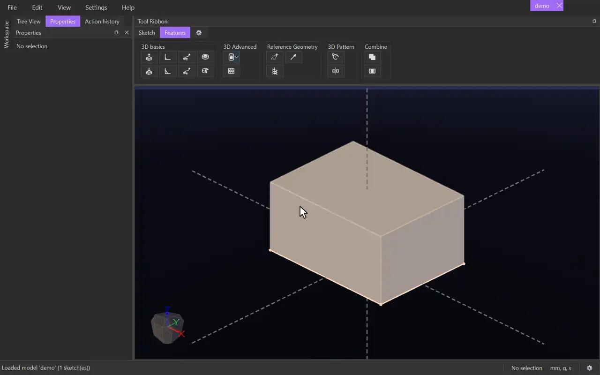

# Chamfer

{.tool-demo}

Bevels the edges of a body with a flat, angled face.

**Where:** Features tab › 3D basics · **Shortcut:** none (available from the command palette, Ctrl+Shift+P)

## How to use
1. Make sure the model has at least one body. Optionally select the edges to bevel first.
2. Click **Chamfer**. Any sketch being edited is closed, and the Properties panel shows the Chamfer form with the **Edges** box active.
3. Click body edges in the view. Clicking an edge again removes it. Clicking a face adds every edge around it, including the rims of holes.
4. Set the **Distance**, or untick **Symmetrical** and set two distances.
5. Click **Create** (or press Ctrl+Enter). **Cancel** or Escape closes the form.

## Options
- **Edges** — the edges to bevel, with a count shown below. Select a row and press Delete to remove it.
- **Tangential propagation** — on by default. A click also takes every edge of the same body joined smoothly to it. Untick it to pick edges one at a time.
- **Symmetrical** — on by default: the bevel sets back the same **Distance** on both faces. Untick it to give **Distance 1** and **Distance 2**, one for each face, for an uneven bevel.
- **Distance** — how far back from the edge the bevel meets each face. Accepts units and expressions.
- **Preview** — shows the bevel surface as a wire mesh through the solid. With it off, problems are only reported when you click Create.

## Tips
- A drag box while the tool is active selects only edges.
- Edges chamfered in one feature meet cleanly at shared corners, so pick edges that meet at a corner together. Where every edge at a corner is in the same chamfer, the corner gets a flat face of its own (a triangle at a box's corner; at a corner of four or more faces, a few flat faces meeting in the middle).
- A chamfer may run across an earlier fillet or chamfer and blend into it.
- If the distance is too big for the faces beside an edge, the chamfer is refused with a message such as "the faces beside edge-7 leave no room for a blend".
- If there are no bodies yet, the tool says "make a body first -- there are no edges to blend".
- To change a chamfer later, right-click it in the tree and choose **Edit Feature**, or select its body and click **Edit feature** in the Properties panel.
- The form remembers the values you last used.

## See also
- [Fillet](fillet.md) — a rounded edge instead of a flat one.
- [Extrude](extrude.md) — make the body to bevel.

[← 3D basics](../bags/3d_basics.md) · [All documentation](../index.md)
