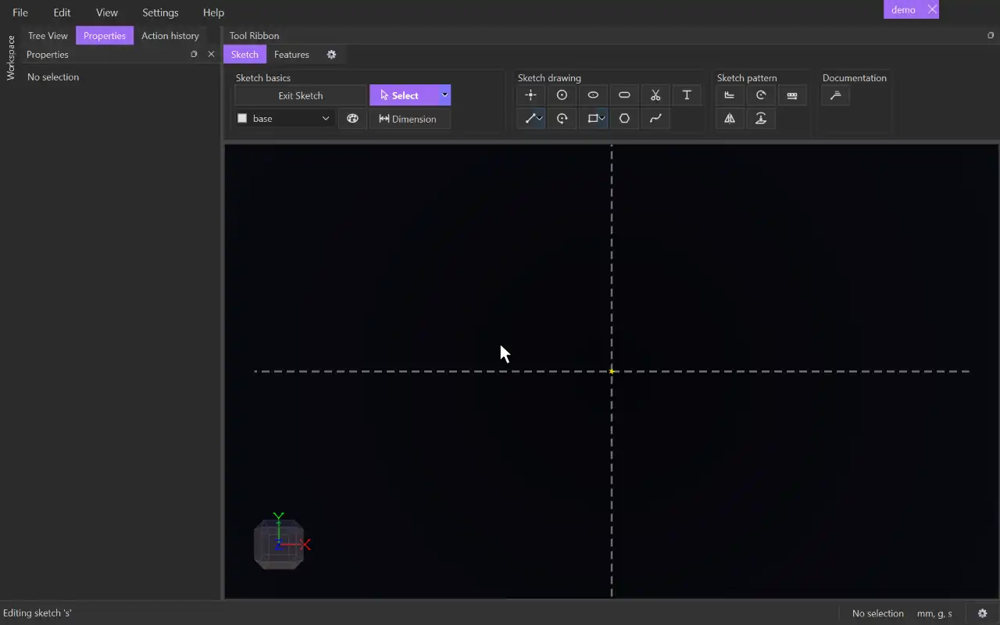

# Circle

{.tool-demo}

Draws a full circle from its centre and a point on its edge.

**Where:** Sketch tab › Sketch drawing · **Shortcut:** C

## How to use
1. Click **Circle**. If you aren't in a sketch yet, click a plane or flat face first to start one.
2. Click to place the centre.
3. Move the cursor. A preview follows it.
4. Click to set the radius. The tool stays active for the next circle.
5. Press Escape to return to [Select](select.md).

## Tips
- The centre snaps like any point. Snap it onto an existing point to share that point, or onto a line or curve to keep it there.
- Escape after placing the centre cancels the circle and removes the centre point, unless something else already uses it.
- The radius is only a starting size. Use [Dimension](dimension.md) on the circle to fix its diameter. Drag the rim with [Select](select.md) to resize it.
- A closed circle makes a 2D surface you can extrude. Several circles that share a centre can take a gap dimension between their edges.
- Select two circles to make them concentric (Shift+O) or equal (Shift+E). Select a circle and a line to make them tangent (Shift+T). The Properties panel lists every constraint that applies.
- Circles go on the tag chosen in the [Tag selector](tag_selector.md).

## See also
- [Arc](arc.md) — part of a circle
- [Ellipse](ellipse.md) — an oval with separate width and height
- [Trim](trim.md) — trim a circle where other curves cross it, turning it into an arc
- [Extrude](extrude.md) — turn the circle's surface into a cylinder

[← Sketch drawing](../bags/sketch_drawing.md) · [All documentation](../index.md)
