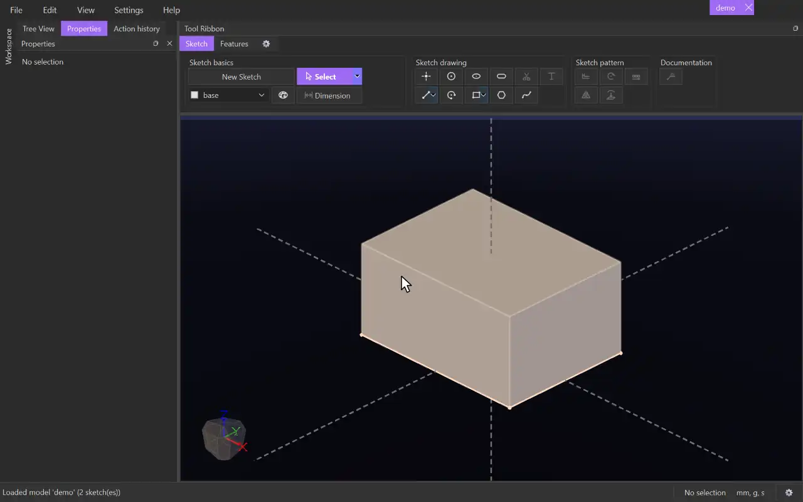

# Cut Extrude

{.tool-demo}

Cuts a sketch's shape out of existing bodies, pushing it straight from the sketch plane. It is Extrude in reverse.

**Where:** Features tab › 3D basics · **Shortcut:** none (available from the command palette, Ctrl+Shift+P)

## How to use
1. Edit a sketch, or select a sketch (or something in one).
2. Click **Cut Extrude**. The sketch's surfaces are filled in automatically, and a preview of the cut appears.
3. Adjust the **Surfaces** if needed: click the box, then click surfaces in the view to add or remove them.
4. Set the **End** and **Start**. A new cut goes into the material automatically. Press **Flip** to send it the other way.
5. Click **Create** (or press Ctrl+Enter). **Cancel** or Escape closes the form.

## Options
- **Surfaces** — the shapes to cut. Select a row and press Delete to remove it.
- **End** / **Start** — how deep the cut goes and where it starts. The End defaults to **Through all**, the Start to a distance of 0. Each one is one of:
  - **Distance** — a distance from the sketch plane, with **Flip**.
  - **Entity** — up to a plane, a flat face, a surface of another sketch, or a point, with **Offset** and **Flip offset**.
  - **Through all** — through every body, with **Flip**.
- **Draft** — tick to taper the cut's walls, in degrees. A positive angle makes the cut narrower as it goes deeper.
- **Auto select bodies** — on by default: the cut removes material from every body with the same tag as the cut's surface. Untick it to choose the bodies in the **Cut** box: click the box, then click bodies in the view to add them, and press Delete or right-click › **Delete** to take selected ones out.

## Tips
- The cut side keeps following your surface picks until you press Flip yourself.
- If the status bar says "cut nothing (no body in its way)", check the direction and the bodies' tags.
- A body the cut removes completely disappears.
- Values accept units and expressions.
- Problems show in red and stop Create, e.g. "nothing to extrude through along the sketch normal".
- To change the cut later, right-click it in the Model tab and choose **Edit Feature**, or select the body and click **Edit feature** in the Properties panel.
- The form remembers the values you last used.

## See also
- [Extrude](extrude.md) — add material the same way.
- [Rotate Cut](rotate_cut.md) — cut by revolving a sketch.
- [Swept Cut](swept_cut.md) — cut along a path.
- [Project](project.md) — bring a face's outline into a sketch to cut through.

[← 3D basics](../bags/3d_basics.md) · [All documentation](../index.md)
