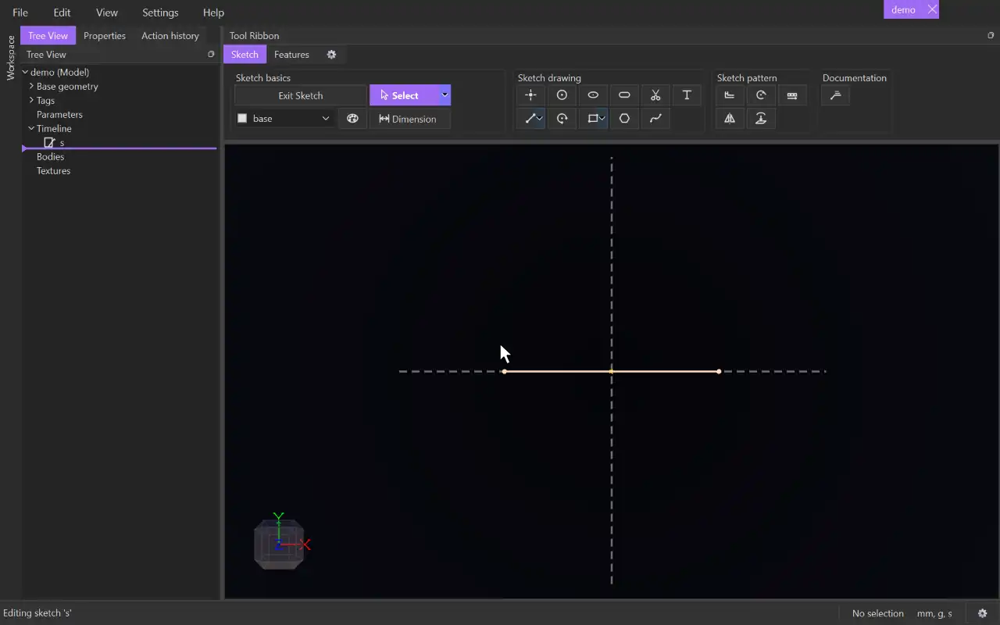

# Dimension

{.tool-demo}

Adds a driving dimension: a length, distance, angle, diameter or gap that the sketch is solved to. The kind of dimension comes from what you select.

**Where:** Sketch tab › Sketch basics · **Shortcut:** D

## How to use
1. Open a sketch and click **Dimension**. Anything already selected is used straight away.
2. Click one or two items. Each click adds to the selection, so no modifier key is needed. The status bar shows what was found, or what is still missing.
3. The number floats under the cursor. Click empty space to put it down.
4. A popup asks for the value. Type a number, a value with units (`25mm`, `1in`) or an expression using parameters, then confirm. The geometry moves to match.
5. The tool stays active for the next dimension.

## Options
What you select decides the dimension:
- **One line** — its length.
- **Two points** — the distance between them.
- **A point and a line** — the perpendicular distance from the point to the line, as if the line went on forever.
- **Two parallel lines** — the distance between them.
- **Two lines that aren't parallel** — the angle between them.
- **A circle or an arc** — its diameter.
- **Two concentric circles or arcs** — the gap between their edges.
- **Horizontal / vertical** — for two points, or a line, move the number straight above or below the items to measure only the horizontal distance, or straight to one side to measure only the vertical distance. A negative value typed for one of these flips it to the other side.

## Tips
- A single point waits for a second one. A selection that can never be measured, such as a point and a circle, is refused with a message in the status bar.
- The same length can't be dimensioned twice (a line and its two end points count as the same length). A line with a length dimension can still take a horizontal and a vertical one.
- Drag a dimension's number to move it. Double-click it, or use the Properties panel, to change the value.
- The first length dimension in a model with only one sketch scales that whole sketch to the value you type, and the status bar says so.
- Items from another sketch can only be measured against items of the sketch you are editing.
- Escape drops the floating number and returns to [Select](select.md).

## See also
- [Select](select.md) — pick items before arming Dimension
- [Line](line.md) and [Circle](circle.md) — the geometry most often dimensioned

[← Sketch basics](../bags/sketch_basics.md) · [All documentation](../index.md)
