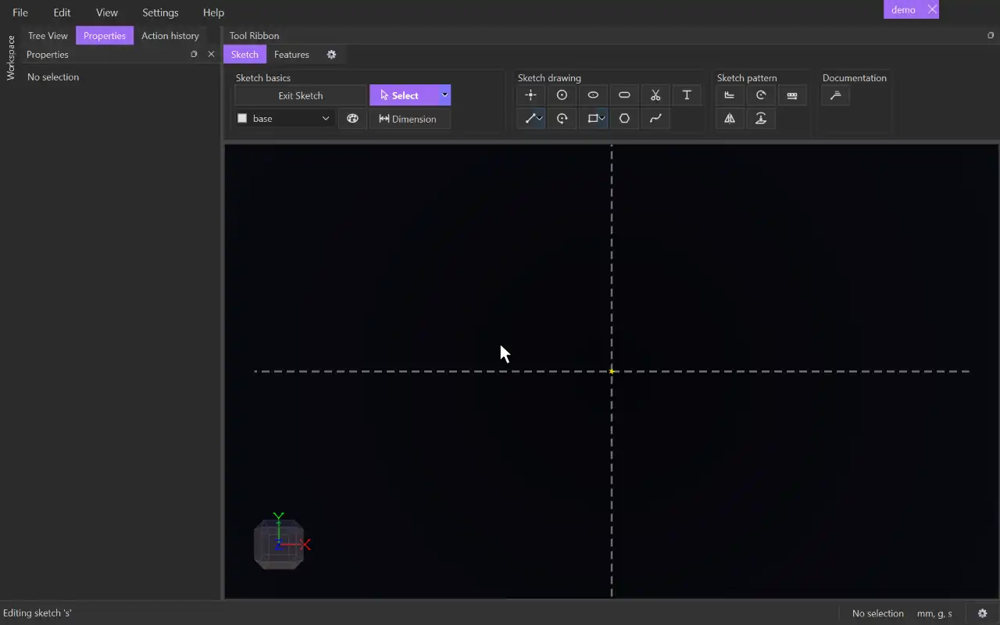

# Ellipse

{.tool-demo}

Draws an ellipse lined up with the sketch's horizontal and vertical directions, from its centre, a width point and a height point.

**Where:** Sketch tab › Sketch drawing · **Shortcut:** none (available from the command palette, Ctrl+Shift+P)

## How to use
1. Click **Ellipse**. If you aren't in a sketch yet, click a plane or flat face first to start one.
2. Click to place the centre.
3. Click to the left or right of the centre to set the half-width. Only the horizontal distance counts.
4. Click above or below the centre to set the half-height. Only the vertical distance counts.
5. The ellipse is created and the tool stays active for the next one.

## Tips
- The width click must be to one side of the centre and the height click above or below it. Otherwise the status bar explains and the click is ignored.
- The ellipse has three points: its centre and the two axis points. These are what snapping and dragging use. You can't snap onto the curve itself or drag it by its outline.
- To size an ellipse exactly, [Dimension](dimension.md) the distance from the centre to each axis point. A diameter dimension doesn't apply to an ellipse.
- Nothing holds the axis points level with the centre after they are placed, so dragging one can tilt the ellipse. Select the centre and an axis point and add **Horizontal** (Shift+H) or **Vertical** (Shift+V) if it needs to stay square to the sketch.
- Escape part-way cancels the ellipse and removes the points it placed, unless something else already uses them. A second Escape returns to [Select](select.md).
- A closed ellipse makes a 2D surface you can extrude.
- [Trim](trim.md) deletes an ellipse that nothing crosses, but it can't cut a piece out of one that is crossed.
- Ellipses go on the tag chosen in the [Tag selector](tag_selector.md).

## See also
- [Circle](circle.md) — when width and height are the same
- [Slot](slot.md) — a rounded oblong with straight sides
- [Dimension](dimension.md) — size it point to point

[← Sketch drawing](../bags/sketch_drawing.md) · [All documentation](../index.md)
