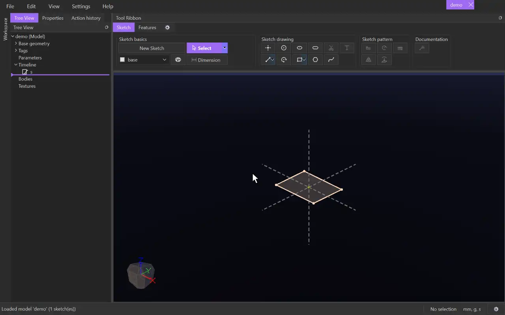

# Extrude

{.tool-demo}

Pushes a sketch's surfaces straight out from the sketch plane to make solid bodies.

**Where:** Features tab › 3D basics · **Shortcut:** none (available from the command palette, Ctrl+Shift+P)

## How to use
1. Edit a sketch, or select a sketch (or something in one) in the view or tree.
2. Click **Extrude**. The sketch's surfaces are filled in automatically, and a preview of the solid appears.
3. To change the surfaces, click the **Surfaces** box and click surfaces in the view. Clicking a picked surface removes it.
4. Set the **End**, and the **Start** if the solid should not begin at the sketch plane.
5. Click **Create** (or press Ctrl+Enter). **Cancel** or Escape closes the form without changes.

## Options
- **Surfaces** — the regions to extrude. Select a row and press Delete to remove it.
- **End** / **Start** — where the solid ends and begins. The Start defaults to a distance of 0, the sketch plane. Each one is one of:
  - **Distance** — a distance from the sketch plane. **Flip** goes the other way.
  - **Entity** — up to a plane, a flat body face, a surface of another sketch, or a point. **Offset** stops short of it by that much, and **Flip offset** goes past it instead.
  - **Through all** — up to the furthest body. **Flip** goes the other way.
- **Draft** — tick to lean the walls by the angle given, in degrees (5 to start with). A positive angle narrows the solid away from the sketch, and a negative angle widens it.
- **Merge result** — on by default. A new body that touches or overlaps a body with the same tag is joined into it.

## Tips
- Values accept units and expressions, e.g. `10mm` or `sizes::depth`.
- Clicking where surfaces overlap picks the smallest first. Click again to step to the next larger one.
- Surfaces are filled in automatically: a lone surface, every separate surface, or the outer surface of a region with holes, which gives a tube.
- When the form opens, it starts on its first empty pick box. If a remembered End is an Entity with no pick yet, that box is active first.
- Problems show in red and stop Create. Examples: "the start and the end are at the same height, so there is nothing to extrude" or "the draft closes the profile before the end".
- After Create, the sketch is hidden and its edit closes.
- To change the extrude later, right-click it in the tree and choose **Edit Feature**, or select a body it made and click **Edit feature** in the Properties panel.
- The form remembers the values you last used, but not the picks.

## See also
- [Cut Extrude](cut_extrude.md) — remove material the same way.
- [Rotate Extrude](rotate_extrude.md) — revolve a sketch instead of pushing it.
- [Swept Extrude](swept_extrude.md) — push a sketch along a path.
- [Fillet](fillet.md) — round the new body's edges.

[← 3D basics](../bags/3d_basics.md) · [All documentation](../index.md)
