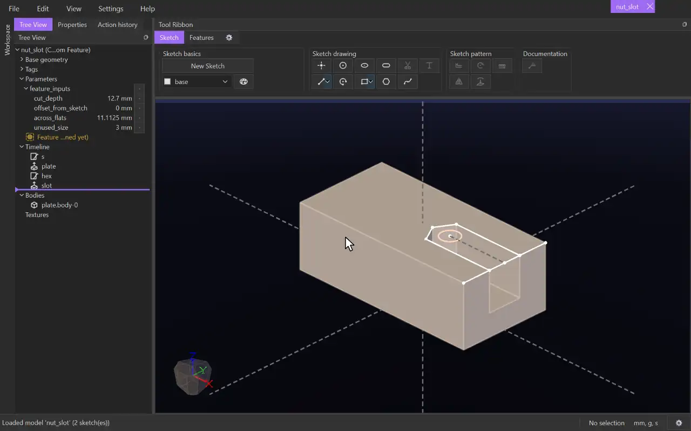

# Feature Definition

{.tool-demo}

Turns sketches and features you have drawn into a custom feature: a tool other models can use, built from what they pick.

**Where:** Features tab › Custom Feature (custom feature files only) · **Shortcut:** none (available from the command palette, Ctrl+Shift+P)

## How to use
1. Open or create a custom feature file (`.fcaden.py`) and draw the feature, together with whatever it is drawn on. For a nut slot, that means a plate with a hole, then a sketch on the plate and a cut.
2. Click **Feature Definition**. The Properties panel shows its first step.
3. Click the sketches and features the custom feature is made of, in the tree or the view. Click one again in the view to take it out.
4. Click **Next**. The panel lists everything they need from outside themselves: a hole's edge, a face, a feature that comes before them.
5. Give each one a name, such as **Hole Arc** or **Stop Face**. A model using the custom feature picks these.
6. Click **Done**. The **Feature Definition** entry appears in the tree, in gold.

## Options
- **Items** — the sketches and features that make up the custom feature, in timeline order.
- **Inputs** — one name for each external dependency. Each input keeps its kind (a circle, a face, a line, and so on) and how it lies against the sketch plane. A pick that doesn't match is refused where the feature is used.

## Tips
- Whatever a sketch projects or constrains to from outside the group is an input, including projected edges.
- When every input a sketch uses lies in its plane, or stands across it (a circle in the plane, a face square to it), the sketch plane is worked out from them. Otherwise the plane becomes an input of its own.
- If you pick a feature but not the feature it is built on, that earlier feature becomes an input.
- Parameters in a group named `feature_inputs` are asked for when the feature is used, with this file's values as the defaults. One that nothing uses is not asked for. Any other value is fixed.
- Double-click the **Feature Definition** entry, or click the tool again, to change it. Right-click it to remove it.

## See also
- [Custom features](../guides/custom_features.md) — making, keeping and using them.
- [Project](project.md) — bring outside geometry into a sketch.

[← Custom Feature](../bags/custom_feature.md) · [All documentation](../index.md)
