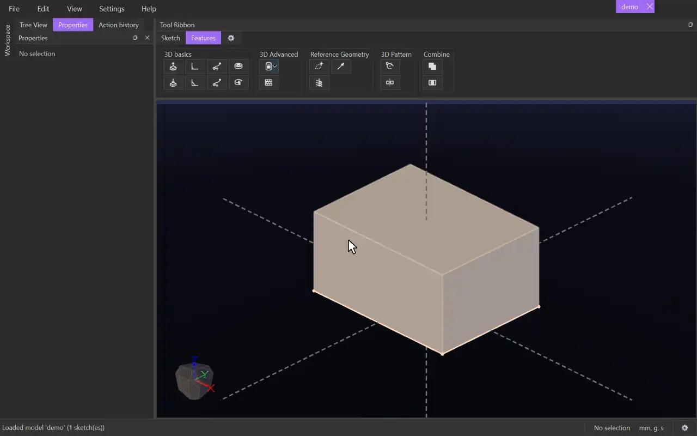

# Fillet

{.tool-demo}

Rounds the edges of a body. Material is taken off outside corners and filled into inside corners.

**Where:** Features tab › 3D basics · **Shortcut:** none (available from the command palette, Ctrl+Shift+P)

## How to use
1. Make sure the model has at least one body. Optionally select the edges to round first.
2. Click **Fillet**. Any sketch being edited is closed, and the Properties panel shows the Fillet form with the **Edges** box active.
3. Click body edges in the view. Clicking an edge again removes it. Clicking a face adds every edge around it, including the rims of holes.
4. Set the **Distance**. The preview shows the surface the fillet will leave.
5. Click **Create** (or press Ctrl+Enter). **Cancel** or Escape closes the form.

## Options
- **Edges** — the edges to round, with a count shown below. Select a row and press Delete to remove it.
- **Tangential propagation** — on by default. A click also takes every edge of the same body joined smoothly to it, such as the rest of a rounded outline. Untick it to pick edges one at a time.
- **Symmetrical** — on by default: one **Distance** on both faces. Untick it to set **Distance 1** and **Distance 2** separately for each face.
- **Distance** — how far back from the edge the fillet meets each face. Accepts units and expressions.
- **Radius scalar** — from 0 to 1, typed or set with the slider. 1 is the largest round that is tangent to both faces, and 0 is a flat bevel.
- **Preview** — shows the fillet surface as a wire mesh through the solid. With it off, problems are only reported when you click Create.

## Tips
- A drag box while the tool is active selects only edges.
- Edges picked in one fillet meet cleanly where they share a corner. Where every edge at a corner is in the same fillet, the corner gets its own smooth surface: a ball's when the faces are square to each other and the sizes equal, otherwise a fitted patch that runs on smoothly from each fillet. Put edges that meet at a corner in the same fillet for the neatest result.
- A fillet may run across the surface of an earlier fillet or chamfer and blend into it.
- If a distance is too large for the faces beside an edge, the fillet is refused with a message such as "the faces beside edge-12 leave no room for a blend". Edges whose faces meet smoothly give "nothing to blend".
- To change a fillet later, right-click it in the Model tab and choose **Edit Feature**, or select its body and click **Edit feature** in the Properties panel.
- The form remembers the values you last used.

## See also
- [Chamfer](chamfer.md) — a flat bevel instead of a round.
- [Extrude](extrude.md) — make the body to round.
- [Cut Extrude](cut_extrude.md) — the holes whose rims you may want to round.

[← 3D basics](../bags/3d_basics.md) · [All documentation](../index.md)
