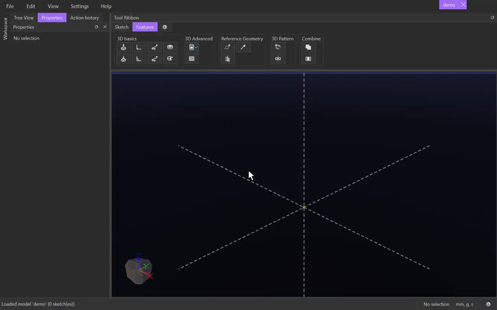

# Helix

{.tool-demo}

Creates a helix (a coil-shaped reference curve) around an axis or a circle. It is drawn in the reference colour like a plane and is not a body. Its main use is as the path of a [Swept Extrude](swept_extrude.md) or [Swept Cut](swept_cut.md), for springs, threads and coils.

**Where:** Features tab › Reference Geometry · **Shortcut:** none

## How to use
1. Optionally select the axis or circle first. It becomes the pick.
2. Click **Helix**. The **Axis / circle** box is active, so click a model axis, a sketch line, a straight body edge or a sketch circle.
3. Choose which two values you want to type in **Defined by**, then fill them in. A live preview follows what you type.
4. Set any extras: start angle, taper, clockwise or spiral.
5. Click **Create** (or press Ctrl+Enter). Escape or **Cancel** discards it.

## Options
- **Axis / circle** — what the helix turns about. It holds only one item, so a new pick replaces the old one. A circle also sets the radius and where the curve starts. A drawn line starts the helix at its first end. A model axis or infinite line starts it at the point nearest the origin.
- **Defined by** — *Pitch and turns*, *Pitch and height*, or *Turns and height*. You type the two named values and the third is worked out.
- **Radius** — how far the curve runs from the axis. It starts at 10, and a picked circle gives its own radius.
- **Pitch** — the rise of one full turn, e.g. `5mm` or `sizes::lead`.
- **Turns** — how many times the curve goes round (a plain number).
- **Height** — the total rise along the axis.
- **Follows** — read-only: the third value, shown when the other two are plain numbers.
- **Start angle** — where the curve starts, in degrees round the axis.
- **Taper** — radius added on each turn. Positive opens out like a cone; negative closes in.
- **Clockwise** — turns the other way round.
- **Spiral (no rise)** — the curve stays flat in one plane and the radius changes with the taper.

## Tips
- Problems appear in red in the form, and **Create** stays disabled until they are fixed. Examples: a taper that shrinks the radius to nothing before the last turn, or a zero radius.
- To change a helix later, right-click it in the Model tab and choose **Edit Helix**.
- A helix follows its axis or circle when that geometry moves.
- The form reopens with the values you used last.

## See also
- [Swept Extrude](swept_extrude.md) — sweep a profile along the helix
- [Swept Cut](swept_cut.md) — cut a thread along the helix
- [Plane](plane.md) — other reference geometry

[← Reference Geometry](../bags/reference_geometry.md) · [All documentation](../index.md)
