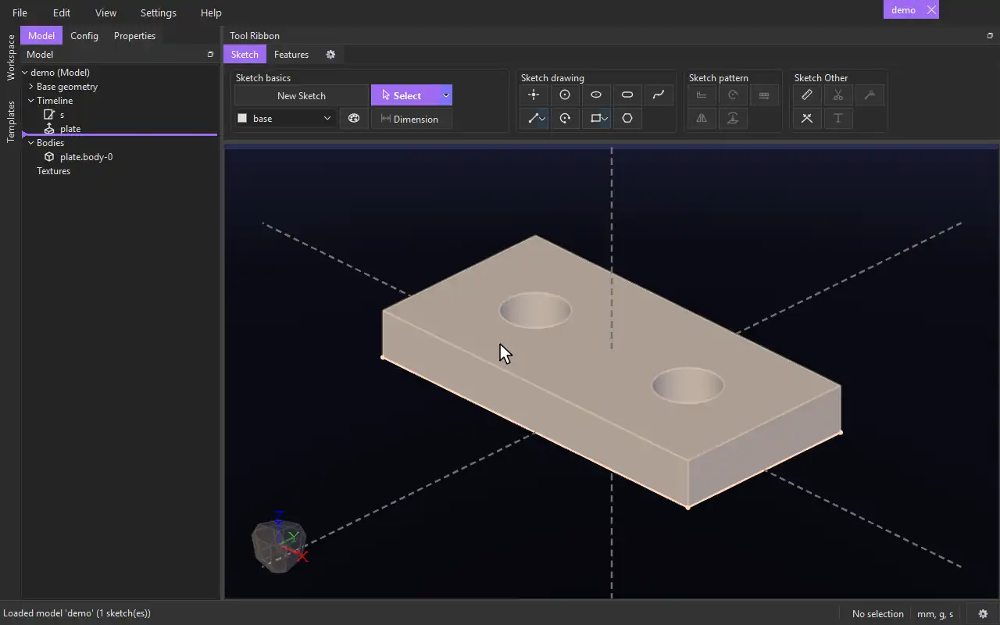

# Import Model

{.tool-demo}

Brings another model into this one whole: its bodies to build on, and its sketches, planes and vectors to build from. It stays linked to its file.

**Where:** Features tab › 3D Advanced · **Shortcut:** none (available from the command palette, Ctrl+Shift+P)

## How to use
1. Click **Import Model** and choose a model file (`.json.caden` or `.py.caden`).
2. Choose the options: **Manually place model** (place it with constraints; unticked, it goes where it is in its own file) and **Import parameters as well**.
3. Placed manually, the Model Import form opens in the Properties panel: click a constraint tool, click a face of the imported model and one of yours, then **Create**. Add more, or drag the model while the form is open.
4. Click **Done**: it is fixed where it stands.

## Tips
- The same as **File › Import › Model...**, and as right-clicking a model file in the Workspace panel › **Import Model**.
- Its bodies are named `<import>.<body>`; build on them like your own -- the imported file never changes.
- Its sketches, planes and vectors are listed under it on the timeline, hidden: right-click one › **Show**.
- Save the imported model and every open model importing it updates.
- Right-click it on the timeline › **Edit Feature** to change its constraints.

## See also
- [Importing a model](../guides/model_import.md) — the whole story: placing, what it brings, the link to its file.

[← 3D Advanced](../bags/3d_advanced.md) · [All documentation](../index.md)
