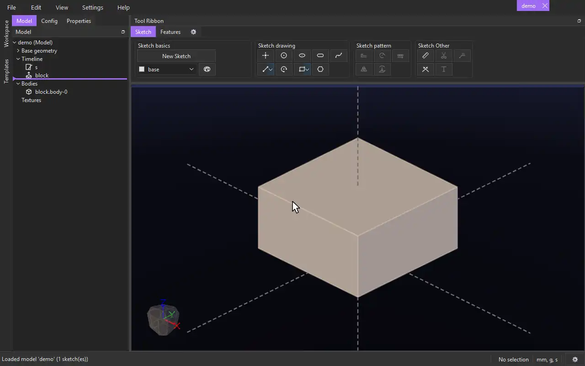

# Infill

{.tool-demo}

Leaves cavities inside a body when it is exported to STL: close-packed spheres, or channels with a round or rectangular section running along a line. The body in the model is not changed.

**Where:** 3D Prints bag (hidden until you add it to a tab) · **Shortcut:** none (available from the command palette, Ctrl+Shift+P)

## How to use
1. The **3D Prints** bag isn't on the ribbon at first: click the gear tab at the end of the ribbon to open the Tool Ribbon Editor, and drag **3D Prints** onto a tab.
2. Click **Infill**. Any sketch being edited is closed. If a face was selected, its body is already in the **Body / feature** box.
3. Otherwise click a face of the body to fill the whole body, or a feature in the Model tab to fill only the material that feature added.
4. Choose the **Shape** and its sizes. For channels, click the **Along** box and then a line, an axis or a straight body edge. For rectangles, also click the **Width along** box and then a second line.
5. While the form is open the cavities are drawn as outlines, and **Fits** says how many there are, or why the infill is invalid. While you type a number the outlines wait until you pause (three quarters of a second).
6. Click **Create** (or press Ctrl+Enter). **Cancel** or Escape takes it away again.

## Options
The defaults are tuned for 3D printing: 0.5 mm spheres, Auto Spacing on with a 1.25 mm spacing, and a 0.75 mm margin.

- **Shape** — **Spheres** (close packed), **Circles** (round channels) or **Rectangles** (rectangular channels).
- **Diameter** — the spheres' or the circles' diameter.
- **Width** / **Length** — a rectangle's size: the width points along the **Width along** line.
- **Auto Spacing** — off by default. On, spheres and circles are spread out so the outermost shapes reach the margin on every side: each direction is stretched on its own, and never closer than the spacing you typed. Rectangles keep one spacing for the whole grid, widened (at most to 1.5 times what you typed) to leave the least room at the margins. **Fits** says the least spacing that came out.
- **Spacing** — the solid gap left between neighbouring shapes. It must be more than 0: shapes may not touch. With Auto Spacing it is the least gap.
- **Margin** — the wall left between the cavities and the outside of the body.
- **Diameter**, **Width**, **Length** — in the model's units. A cavity smaller than your printer can make (a fraction of a millimetre) is in the STL but the slicer ignores it.
- **Along** — the line the channels run along. They run from wall to wall, and are split where the body is cut away.
- **Width along** — the line the rectangles' width points along. It must cross the **Along** line.

## Tips
- The cavities only go into STL exports. The body you see, its volume and a STEP export stay solid.
- The grid of shapes is centred on a box taken when the infill is made: the whole body's when you picked the body, or only that feature's own material when you picked a feature (as if it had been made without merging into anything). Later edits before the infill don't move it.
- Infills whose boxes overlap or touch, even only at an edge, and that have the same shape and values are one: a single grid runs through both boxes with no seam between them, and **Fits** says which infill it is one with. The cavities still stay the margin inside the finished body, so none is ever cut into the outside.
- An infill touching another one with a different shape or values is invalid. Below the error the form asks whether to use the other infill's parameters for this one; **Yes, use them** copies them (as written) and the two become one.
- An invalid infill is left out of the STL, and the export says so.
- Infill is a step in the timeline: to change it later, right-click it in the Model tab and choose **Edit Feature**.

## See also
- [Overhang](overhang.md) — chamfer overhangs so the part prints without supports.

[← 3D Prints](../bags/3d_prints.md) · [All documentation](../index.md)
