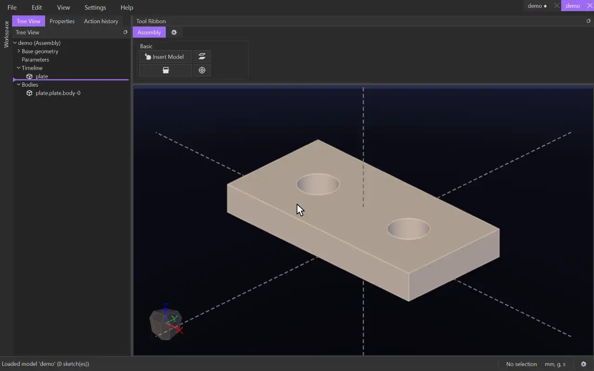

# Insert Model

{.tool-demo}

Brings a model file (or another assembly) into the assembly. Each model keeps its own coordinates; the assembly only moves and turns it.

**Where:** Assembly tab › Basic · **Shortcut:** none (available from the command palette, Ctrl+Shift+P)

## How to use
1. Open or create an assembly (File › New Assembly, or the welcome page's **New Assembly**).
2. Click **Insert Model** and choose a model file (`.json.caden` or `.py.caden`) or an assembly (`.json.acaden` or `.py.acaden`).
3. The model follows the cursor, sliding on the plane through the origin that faces you. Move it roughly into place.
4. Click to place it. Press Escape instead to leave it out.

## Tips
- The first model inserted is **fixed**: it stays where it is and the others move around it. Right-click any model in the tree to **Fix** or **Unfix** it.
- Drag a model with the left mouse button to move it parallel to the screen. Select it, then drag with the right mouse button to turn it about its centre (a right-click without dragging still opens the menu). Both moves stay within what its constraints allow.
- A model in other units is brought in at its real size (a 1 in part is 25.4 mm long in a mm assembly).
- Inserting the same model twice gives it two names (`arm`, `arm-2`); both read the same file.
- An inserted assembly moves as one piece, held together by its own constraints.
- Double-click a model (in the view or the tree) to open its file in a tab. Save it there and the assembly updates.

## See also
- [Coincident](mate_coincident.md) — put two flat faces together.

[← Basic](../bags/assembly_basic.md) · [All documentation](../index.md)
