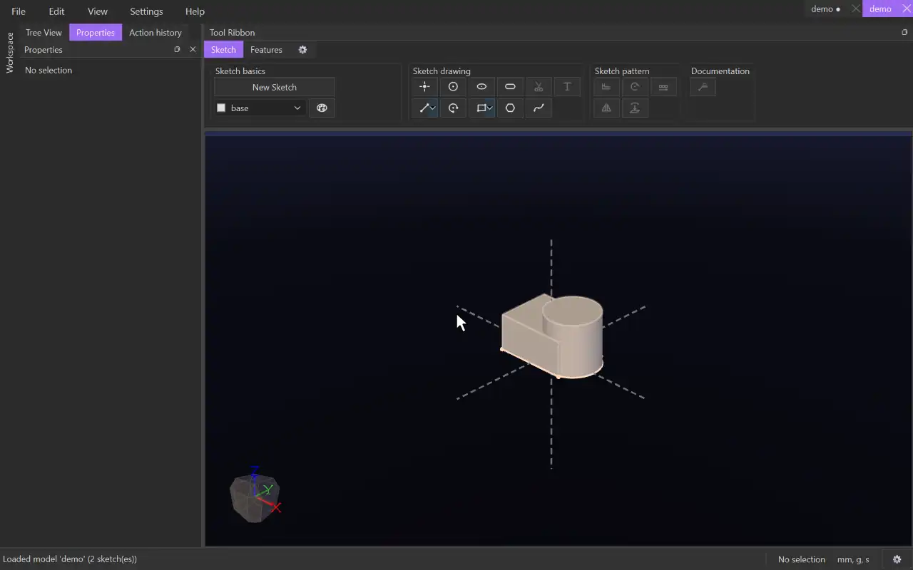

# Intersect

{.tool-demo}

Splits overlapping bodies into all their separate pieces, then lets you choose which pieces to keep. Two bodies that partly overlap become three pieces: the overlap, and the part of each body outside it.

**Where:** Features tab › Combine · **Shortcut:** none

## How to use
1. Optionally select the bodies first (click a face of each). They become the first picks.
2. Click **Intersect**. The **Bodies** box is active, so click the bodies to split. Click a body again to remove it.
3. When at least two bodies are picked, click **Create**. The bodies are split, and the form stays open with a **Pieces** list.
4. To drop a piece, untick it in the list or click it in the 3D view. A dropped piece stays on screen in the cut colour while the form is open, and clicking it again brings it back.
5. Click **Done** to finish. Escape or **Cancel** leaves the form.

## Options
- **Bodies** — the bodies to split apart (two to six). Select a row and press Delete to remove it.
- **Pieces** — every piece the bodies split into, each with a check box. Ticked pieces are kept; unticked pieces are dropped from the result. Each piece is labelled with the bodies it lies inside, joined by `+`, followed by its volume. For example, `A.body-0+B.body-0` is the overlap of A and B, and `A.body-0` is the part only in A. Hover a row to see the full list.

## Tips
- After the feature, the kept pieces are bodies in their own right and the original bodies are used up. Later features, sketches and picks work on the pieces.
- Being able to treat the overlap as its own body is the main use: for example, keep only the shared region of two shapes, or keep everything except it.
- Bodies that don't touch at all don't produce an overlap piece.
- More than six bodies are refused, because the number of possible pieces doubles with each body.
- A dropped piece stays dropped when the input bodies change shape later, because pieces are identified by which bodies they lie inside, not by their position in the list.
- To change the kept pieces later, right-click the feature under **Features** in the tree and choose **Edit Feature**. The pieces come back on screen to switch on and off.

## See also
- [Join](join.md) — unite touching bodies into one instead
- [Mirror](mirror_feature.md) — mirror bodies before splitting them
- [Rotate](rotate_feature.md) — repeat bodies around an axis
- [Cut Extrude](cut_extrude.md) — remove material with a sketch instead

[← Combine](../bags/intersect.md) · [All documentation](../index.md)
