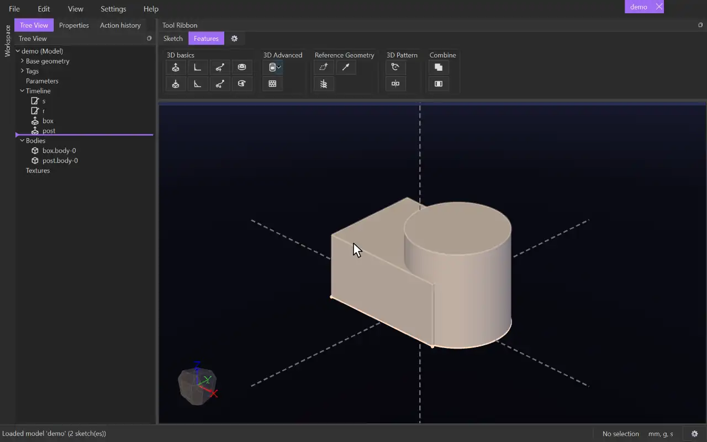

# Join

{.tool-demo}

Unites two or more bodies into a single body. The bodies must touch: they have to overlap, or meet face to face.

**Where:** Features tab › Combine · **Shortcut:** none (available from the command palette, Ctrl+Shift+P)

## How to use
1. Optionally select the bodies first (click one of each body's faces); they start in the form.
2. Click **Join**. Any sketch being edited is closed, and the Properties panel shows the Join form with the **Bodies** box active.
3. Click a face of each body to join. Clicking a body again takes it out of the box.
4. Click **Create** (or press Ctrl+Enter). The bodies are replaced by one body, named after the feature (for example `join-0.body-0`).

## Options
- **Bodies** — the bodies to join, in the order you picked them. Select a row and press Delete to remove it.

## Tips
- Bodies count as touching when they overlap, or share part of a face. Bodies that meet only along an edge or at a single point, or that are apart, can't be joined: the form names the body that doesn't touch the others and **Create** stays off until you take it out.
- A chain is fine: if A touches B and B touches C, all three join even though A and C don't meet.
- If the bodies have different tags, you are asked which tag the joined body should take. If they all share a tag, the joined body keeps it.
- The picked bodies are used up: later features see only the joined body. To change which bodies are joined, right-click the Join in the Model tab and choose **Edit Feature** — the model goes back to just before the Join so its bodies are there to pick again; **Update** applies, **Cancel** leaves it as it was.
- Extrude's **Auto Merge** joins a new extrusion into the touching bodies of the same tag as it is made; Join is for bodies that already exist.

## See also
- [Intersect](intersect.md) — split bodies into their overlapping and separate pieces instead.
- [Extrude](extrude.md) — its **Auto Merge** joins as it extrudes.

[← Combine](../bags/intersect.md) · [All documentation](../index.md)
