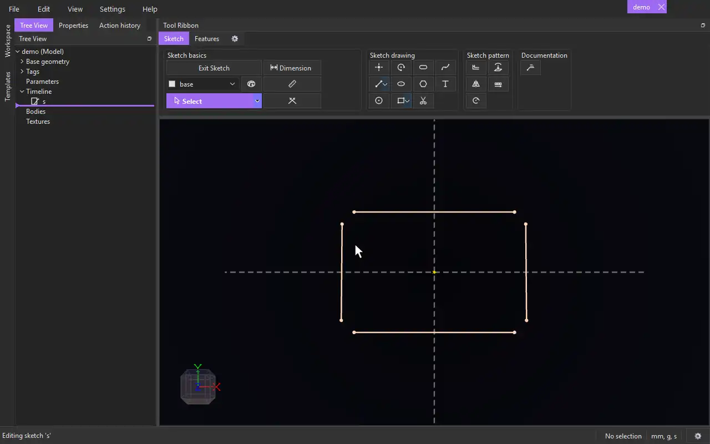

# Join Points

{.tool-demo}

Joins the points of the items you choose that lie close together, with coincident constraints. Use it to close the small gaps in an outline that was drawn or imported without its ends snapped together.

**Where:** Sketch tab › Sketch basics

## How to use
1. Edit a sketch. Optionally select the items to join first.
2. Click **Join Points**. The Properties panel shows the Join Points form.
3. Click the **Items** box, then click the points, lines, arcs, circles and other items whose points should meet. Clicking an item again removes it.
4. Set the **Join tolerance**. The form says how many points Join will join.
5. Click **Join** (or press Ctrl+Enter). **Cancel** or Escape closes the form.

## Options
- **Items** — anything with points: points, lines, arcs, circles (their centre), ellipses, splines, and another sketch's items or a body's edges as partners.
- **Join tolerance** — how close two points must be to be joined. 0.1 mm by default. Any value works, such as `0.5mm` or a parameter.

## Tips
- Only the points of different items are joined: a line's two ends are never joined to each other.
- Three or more points close together are all joined to the same one.
- Points that are already joined are left as they are. If there is nothing to join, Join stays off.
- A line's middle isn't one of its points here, so a line is never joined at its middle.
- Join is one step in the history: one Ctrl+Z undoes all of it.
- Joined ends close an outline into a surface you can extrude.

## See also
- [Select](select.md) — Joined select picks a whole joined outline with one click
- [Trim](trim.md) — cut overlapping pieces away

[← Sketch basics](../bags/sketch_basics.md) · [All documentation](../index.md)
