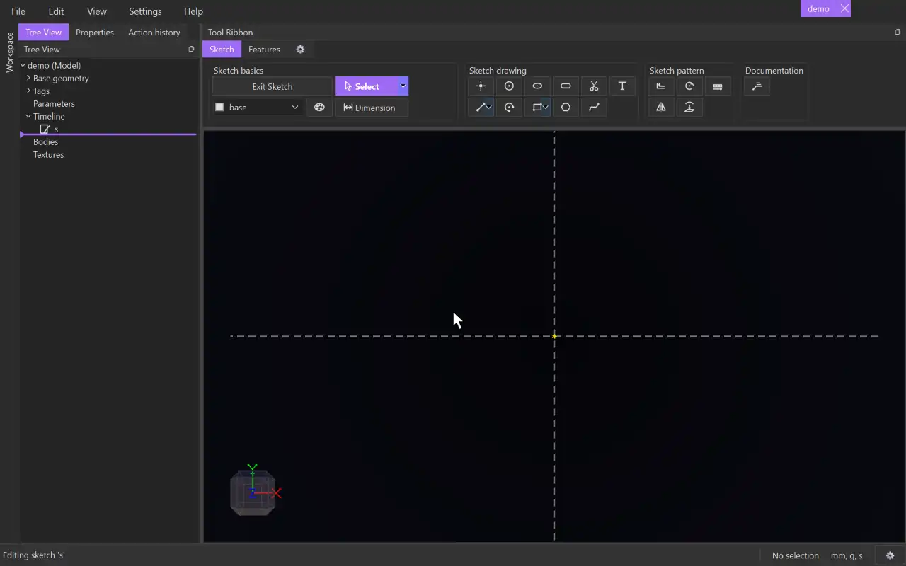

# Line

{.tool-demo}

Draws straight line segments, chained end to end. The **Polyline** variant draws one connected item from many segments.

**Where:** Sketch tab › Sketch drawing · **Shortcut:** L (Polyline: Alt+L)

## How to use
1. Click **Line**. If you aren't in a sketch yet, click a plane or flat face first to start one.
2. Click to place the start point.
3. Click to place the end point. The next line starts from there.
4. Keep clicking to chain more lines. Press Escape to stop the chain. Press Escape again to return to [Select](select.md).

## Options
- **Line / Polyline** — use the small arrow on the button to switch. The button keeps the variant you chose.
  - **Line** makes separate lines that share their end points.
  - **Polyline** makes one item. Each click adds a corner. Click the first point again (after at least three points) to close it. A double-click or Escape finishes it, and the next click starts a new one.

## Tips
- **Quick length:** after the first point, point the line the way you want and type a length (a box opens at the cursor on the first digit; units and expressions work, such as `40`, `40mm` or `2*width`). Enter moves the end to that length, keeping the angle. Press Enter again (or click) to place it. Moving the mouse lets the end follow the cursor again. No dimension is made.
- Enter with nothing typed places the point under the cursor, as a click does.
- A line drawn within about 7 degrees of horizontal or vertical snaps straight and gets a horizontal or vertical constraint.
- Ends snap to nearby points and curves. A snapped end is constrained to that point or curve.
- Rest the cursor near a point or line for a moment and dashed guides appear: a point's horizontal and vertical, or a line's extension. Where two guides cross is a snap too. Resting on a curve for longer leaves a temporary point whose guides you can use.
- Escape before the second click removes the start point, unless something else already uses it. Lines already drawn in a chain stay.
- A line that would end up with zero length is refused, and the status bar says why.
- With the sketch grid on, ends land on the grid when nothing else catches the cursor.
- Lines go on the tag chosen in the [Tag selector](tag_selector.md). Draw on **construction** for helper lines.

## See also
- [Rectangle](rectangle.md) — four constrained lines in two clicks
- [Spline](spline.md) — a smooth curve through points
- [Dimension](dimension.md) — set a line's length or the angle between two lines
- [Trim](trim.md) — cut lines back to where they cross

[← Sketch drawing](../bags/sketch_drawing.md) · [All documentation](../index.md)
