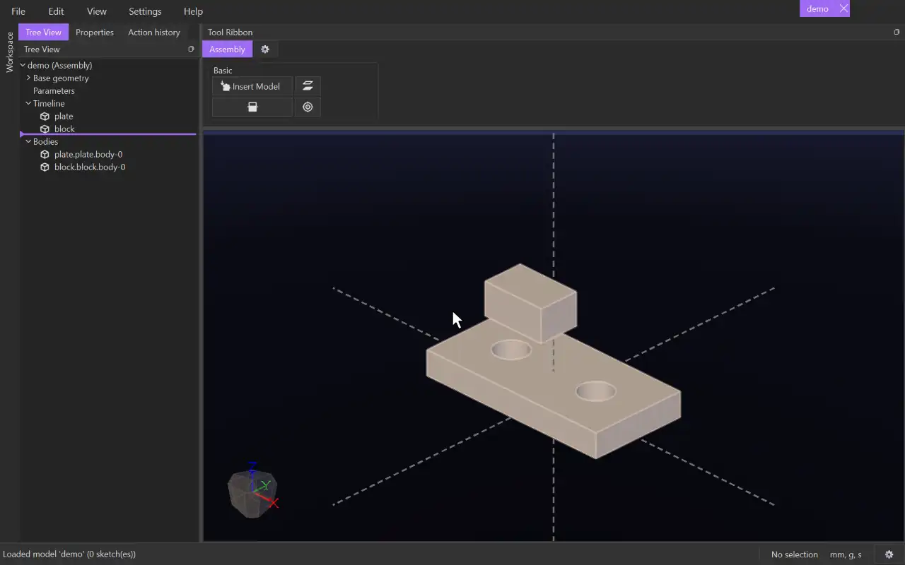

# Coincident

{.tool-demo}

Puts two flat faces on one plane, facing each other, with an optional gap between them.

**Where:** Assembly tab › Basic · **Shortcut:** none (available from the command palette, Ctrl+Shift+P)

## How to use
1. Click **Coincident**. The Properties panel shows its form with the **Face A** box active.
2. Click a flat face of one model, or a base plane. **Face B** becomes active.
3. Click a flat face of another model. The models move to show the result.
4. Set **Distance** for a gap, or tick **Flip** to make the faces point the same way (flush) instead of face to face.
5. Click **Create**.

## Options
- **Face A / Face B** — the two faces. Click a box to make it the one the next click fills.
- **Distance** — the gap between the faces, along Face A's outward direction. A number, an expression or a parameter.
- **Flip** — the faces point the same way instead of facing each other.

## Tips
- Fixed models never move; the other model comes to meet them.
- A constraint that can't be met together with the others is refused, and the form says so.
- Right-click it in the Model tab to **Edit Constraint** or **Suppress** it; Delete removes it.

## See also
- [Parallel](mate_parallel.md) — only line up the faces' directions.
- [Concentric](mate_concentric.md) — line up round faces.

[← Basic](../bags/assembly_basic.md) · [All documentation](../index.md)
