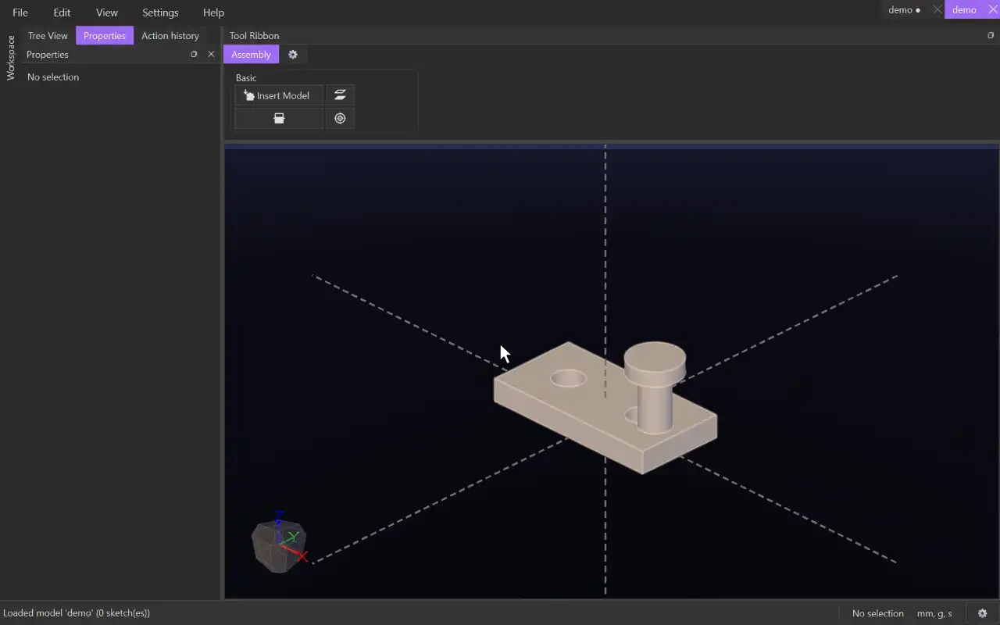

# Concentric

{.tool-demo}

Lines up two round faces (cylinders or cones) on one axis — a pin in a hole, a shaft in a bearing. A line works as an axis too: a straight edge, one of the base axes, or a model's vector — so a line can be put through a hole, or two lines made collinear.

**Where:** Assembly tab › Basic · **Shortcut:** none (available from the command palette, Ctrl+Shift+P)

## How to use
1. Click **Concentric**. The Properties panel shows its form with the **Face A** box active.
2. Click a round face of one model, for example the inside of a hole.
3. Click a round face of another model, for example a pin. The model moves onto the axis.
4. Click **Create**.

## Options
- **Face A / Face B** — the two round faces, or lines:
  - a straight edge of a model (click it in the view)
  - a base axis (X, Y or Z)
  - a model's vector: expand the model's row in the **Model** tab and click the vector (`model::vector`). A vector runs from its model's origin.

## Tips
- The model can still slide along the axis and turn about it. Add a [Coincident](mate_coincident.md) to set how far in it goes.
- A constraint that can't be met together with the others is refused, and the form says so.
- If a face (or edge) a constraint uses is gone after an edit, its box is red when you edit the constraint. Select it and press Delete, pick a new one, then **Update**. **Update** stays off until every box is fixed; **Cancel** always works.

## See also
- [Coincident](mate_coincident.md) — put two flat faces together.

[← Basic](../bags/assembly_basic.md) · [All documentation](../index.md)
