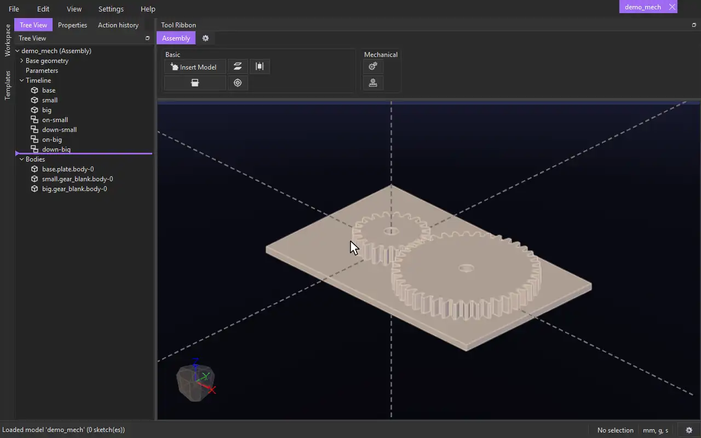

# Geared

{.tool-demo}

Links two models' turns in a fixed ratio, like two gears in mesh: turn one and the other turns with it.

**Where:** Assembly tab › Mechanical · **Shortcut:** none (available from the command palette, Ctrl+Shift+P)

## How to use
1. Place the two models where you want them, each turned the way it should start — for gears, with their teeth in mesh. Hold each one on its axis first, for example with a [Concentric](mate_concentric.md) on its bore and a [Coincident](mate_coincident.md) on its face.
2. Click **Geared**. The Properties panel shows its form with the **Gear A** box active.
3. Click a round face of the first model, then a round face of the second (a gear's bore will do).
4. Click **Create**. From now on, turning one turns the other.

## Options
- **Gear A / Gear B** — a round face of each model. The faces' axes are what the models turn about.
- **Ratio** — how many turns Gear B makes for each turn of Gear A. Empty: Gear A's diameter over Gear B's. For a model made from the builtin spur gear template, that is its pitch diameter (so the ratio is the teeth ratio); for anything else it is the picked face's diameter.
- **Flip (turn the same way)** — gears in mesh turn opposite ways; tick this for a belt, a chain or an inner gear.

## Tips
- The two models are locked at the turn they have when you click Create. There is no check that teeth actually mesh or that the models don't overlap.
- Turn a model by selecting it and dragging with the right mouse button. Its geared partner follows, however many turns you make.
- A fixed model can't turn, so neither can anything geared to it.

## See also
- [Mechanical](../bags/mechanical.md)
- [Templates](../guides/templates.md) — the builtin spur gear.

[← Mechanical](../bags/mechanical.md) · [All documentation](../index.md)
