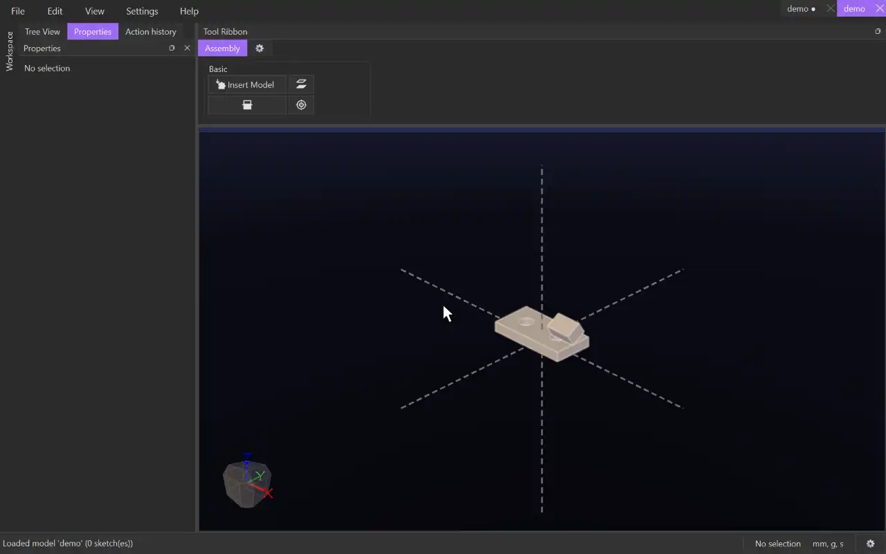

# Parallel

{.tool-demo}

Turns two models so that two flat faces are parallel. Their distance apart is left free.

**Where:** Assembly tab › Basic · **Shortcut:** none (available from the command palette, Ctrl+Shift+P)

## How to use
1. Click **Parallel**. The Properties panel shows its form with the **Face A** box active.
2. Click a flat face of one model, or a base plane.
3. Click a flat face of another model. The model turns to show the result.
4. Click **Create**.

## Options
- **Face A / Face B** — the two flat faces (or a face and a base plane).

## Tips
- The faces may end up facing the same way or opposite ways, whichever is nearer to where they are.
- A constraint that can't be met together with the others is refused, and the form says so.

## See also
- [Coincident](mate_coincident.md) — also bring the faces together.

[← Basic](../bags/assembly_basic.md) · [All documentation](../index.md)
