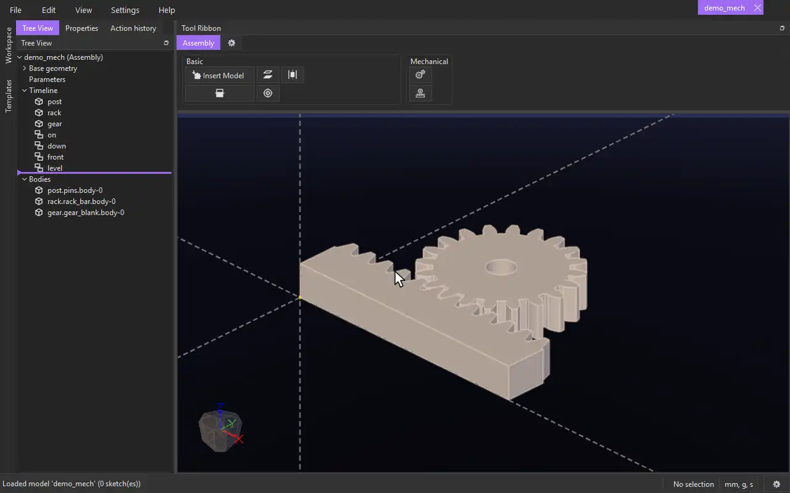

# Rack and Pinion

{.tool-demo}

Links a gear's turn to a rack's travel: turn the gear and the rack slides along, slide the rack and the gear turns.

**Where:** Assembly tab › Mechanical · **Shortcut:** none (available from the command palette, Ctrl+Shift+P)

## How to use
1. Place the gear and the rack where you want them, with their teeth in mesh. Hold the gear on its axis first, for example with a [Concentric](mate_concentric.md) on its bore and a [Coincident](mate_coincident.md) on its face. Hold the rack so it can only slide along its length, for example with a [Coincident](mate_coincident.md) on its bottom face and another on its back or front face.
2. Click **Rack and Pinion**. The Properties panel shows its form with the **Gear** box active.
3. Click a round face of the gear (its bore will do), then a straight edge along the rack.
4. Click **Create**. From now on, turning the gear moves the rack, and sliding the rack turns the gear.

## Options
- **Gear** — a round face of the gear. Its axis is what the gear turns about.
- **Rack edge** — a straight edge running along the rack, the way it slides.
- **Travel per turn** — how far the rack moves for one whole turn of the gear. Empty: pi times the gear's diameter. For a model made from the builtin spur or helical gear template, that is its pitch diameter, which matches the builtin gear racks of the same module. For anything else it is the picked face's diameter.
- **Flip (the rack goes the other way)** — the rack normally moves the way the gear's edge rolls along it. Tick this to send it the other way.

## Tips
- The gear and the rack are locked where they stand when you click Create. There is no check that the teeth actually mesh or that the models don't overlap.
- Turn the gear by selecting it and dragging with the right mouse button. Drag the rack with the left mouse button.
- The constraint doesn't hold the rack in line. Use other constraints to keep it sliding straight.

## See also
- [Geared](mate_geared.md) — two gears turning together.
- [Mechanical](../bags/mechanical.md)
- [Templates](../guides/templates.md) — the builtin gears and gear racks.

[← Mechanical](../bags/mechanical.md) · [All documentation](../index.md)
