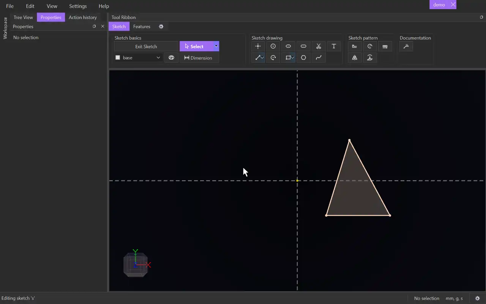

# Mirror

{.tool-demo}

Mirrors sketch geometry across a line. The mirrored copies stay symmetric to the originals.

**Where:** Sketch tab › Sketch pattern · **Shortcut:** Alt+M (while editing a sketch)

## How to use
1. Edit a sketch. Optionally select the geometry to mirror first. If your selection includes exactly one construction line, it becomes the mirror line and everything else goes in the Entities box.
2. Click **Mirror**. The Properties panel shows the Mirror form.
3. If the **Mirror line** box is empty it is active: click the line to mirror across.
4. Click the **Entities** box, then click the points, lines, arcs or circles to mirror. Clicking a sketch surface adds the curves around it. Clicking an item again removes it.
5. Choose whether to tick **Copy Entities**.
6. Click **Create** (or press Ctrl+Enter). **Cancel** or Escape closes the form.

## Options
- **Copy Entities** — ticked (the default) makes ordinary copies held to the originals by symmetry constraints. Unticked makes a Mirror item whose copies are derived: they are rebuilt from the originals and follow every change to them.
- **Mirror line** — the line to mirror across. Any line works, including one from another sketch or a model axis.
- **Entities** — what to mirror. You can also add whole sketches on the same plane from the Model tab. Select a row and press Delete to remove it.

## Tips
- Click a box to choose which one your clicks go into. The active box has a coloured border and only accepts the right kind of item.
- Only an unticked (derived) mirror can be edited later. Right-click it in the Model tab and choose **Edit Mirror**, or select one of its copies and use **Edit mirror** in the Properties panel. Copy Entities can't be changed while editing.
- Deleting a copy made by a derived mirror asks whether to delete the whole mirror.
- Copies made with Copy Entities ticked are normal geometry. Deleting the symmetry constraint frees them.
- Points you joined with a coincident constraint stay joined in the copies, so a closed outline mirrors as a closed outline (and gets its own surface).
- The form remembers whether you last used Copy Entities.

## See also
- [Rotate](rotate.md) — copy geometry around a centre instead.
- [Pattern](pattern.md) — repeat geometry along a direction or in rings.
- [Offset](offset.md) — copy curves a set distance away.

[← Sketch pattern](../bags/sketch_pattern.md) · [All documentation](../index.md)
