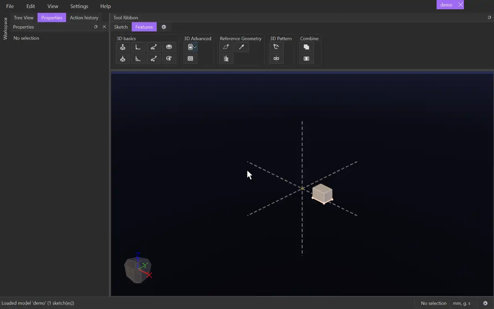

# Mirror

{.tool-demo}

Mirrors 3D features or whole bodies across a plane, keeping the originals. A mirrored raise adds material and a mirrored cut removes it, just as the original feature does.

**Where:** Features tab › 3D Pattern · **Shortcut:** none

## How to use
1. Optionally select the bodies first (click their faces). They become the first items.
2. Click **Mirror**. If there is no plane yet, the **Plane** box is active. Click a plane, a sketch (to use its plane) or a flat body face.
3. Click the **Items** box, then click a body's face to add the feature that made that face. Double-click a face to use the whole body instead. You can also click features or bodies in the tree.
4. A ghost preview shows the mirrored result.
5. Click **Create** (or press Ctrl+Enter). Escape or **Cancel** leaves without changes.

## Options
- **Plane** — the mirror plane: a model plane (XY, YZ, ZX), a custom plane, a sketch's plane, or a flat body face.
- **Items** — the features and bodies to mirror, applied in the order you picked them. Select a row and press Delete to remove it.
- **Auto Merge** — on by default. Each mirrored copy joins the touching bodies with the same tag that are shown when you click Create or Update. CADen saves which bodies those were, so hiding or showing a body later changes nothing.
  - Untick it to choose instead: tick **Merge with all** to join every touching body with the same tag, hidden or not, checked again each time the model rebuilds; or pick the bodies to merge with in the list (each one it touches joins it). Pick none for a separate body.

## Tips
- A face click adds the *feature* that produced the face, such as an Extrude or a Cut Extrude. The mirrored copy then behaves like that feature: a raise merges into the bodies it touches, and a cut subtracts from every body it crosses.
- Double-clicking swaps that feature for its whole body, which is then mirrored as a separate solid (merged as Auto Merge or your choice says).
- To mirror across a plane that doesn't exist yet, make one first with the [Plane](plane.md) tool.
- The mirror follows its plane and its source features. Edit the original and the mirrored copy updates.
- To change it later, right-click it under **Features** in the tree and choose **Edit Feature**.
- An unsuitable plane pick is refused with a message in the status bar.
- The Mirror on the Sketch tab is a different tool: it mirrors sketch geometry across a line.

## See also
- [Rotate](rotate_feature.md) — repeat features around an axis
- [Plane](plane.md) — make a mirror plane
- [Intersect](intersect.md) — split bodies where they overlap

[← 3D Pattern](../bags/3d_pattern.md) · [All documentation](../index.md)
