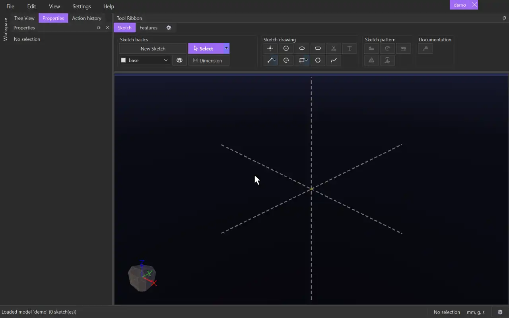

# New Sketch

{.tool-demo}

Starts a new 2D sketch on a plane or a flat face of a body and opens it for editing. While you are in a sketch the same button reads **Exit Sketch** and takes you back out.

**Where:** Sketch tab › Sketch basics · **Shortcut:** none

## How to use
1. Click **New Sketch**. The button highlights, the base planes (and any custom planes) appear in the view, and the camera turns to a corner view.
2. Click a plane or a flat face of a body. The sketch is created on it, the view turns to look straight at it, and the ribbon switches to the **Sketch** tab.
3. Draw with the [Sketch drawing](../bags/sketch_drawing.md) tools.
4. Click **Exit Sketch** when you are done. The camera stays where it is.

## Tips
- If a plane, a flat body face or a 2D sketch surface is already selected when you click **New Sketch**, the sketch starts on it straight away. A sketch surface puts the new sketch on that surface's plane.
- Press Escape while the planes are showing to cancel without making a sketch.
- You don't have to click **New Sketch** first. Picking a drawing tool such as [Line](line.md) outside a sketch starts the plane pick for you, and that tool is ready as soon as you click a plane.
- In the tree, right-click a plane or a sketch and choose **New Sketch** to skip the plane pick. Right-click a sketch and choose **Edit Sketch** to reopen it.
- A sketch you leave without drawing anything in it is removed automatically.
- New Sketch and Exit Sketch are also in the command palette (Ctrl+Shift+P), where you can give them a key in **Keybindings**.
- [Dimension](dimension.md), [Trim](trim.md) and [Text](text.md) only work inside a sketch, so their buttons are greyed out until you start or open one.

## See also
- [Plane](plane.md) — make a custom plane to sketch on
- [Select](select.md) — pick and drag what you have drawn
- [Extrude](extrude.md) — turn a finished sketch into a solid

[← Sketch basics](../bags/sketch_basics.md) · [All documentation](../index.md)
