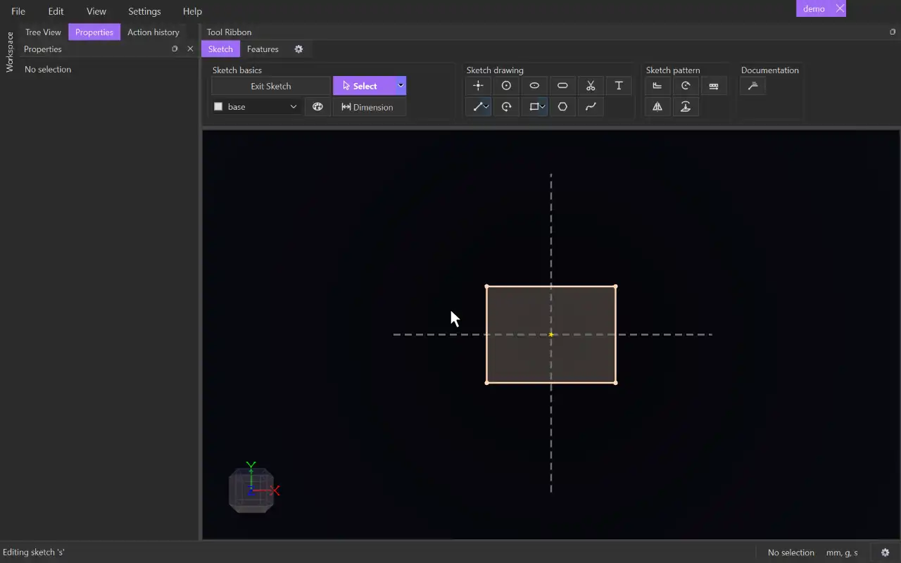

# Offset

{.tool-demo}

Makes copies of lines, arcs and circles a set distance to one side of the originals. The copies stay linked, so they follow when the originals move.

**Where:** Sketch tab › Sketch pattern · **Shortcut:** O (while editing a sketch)

## How to use
1. Edit a sketch. Optionally select the lines, arcs or circles you want to offset first.
2. Click **Offset**. The Properties panel shows the Offset form with the **Entities** box active.
3. Click the curves to offset in the view. Clicking a curve already in the box removes it. Clicking a sketch surface adds the curves around it.
4. Type a **Distance**. A preview of the result is drawn as you type.
5. Press **Flip** if the copies are on the wrong side.
6. Click **Create** (or press Ctrl+Enter). **Cancel** or Escape closes the form without changes.

## Options
- **Entities** — the lines, arcs and circles to offset, from the sketch being edited. Select a row and press Delete to remove it.
- **Distance** — how far away the copies sit. Accepts units and expressions, e.g. `2mm` or a parameter.
- **Flip** — puts the copies on the other side.

## Tips
- A closed loop is offset as a whole: outward by default, inward with Flip, whichever way it was drawn. Curves stretch or trim to meet their neighbours. Pieces that shrink away are dropped, and a loop that would cross itself is split.
- An open chain or a single line is offset to the left of the direction it was drawn. A lone circle grows and a lone arc shrinks. Flip reverses any of these.
- If the offset can't be built, a red message explains why and nothing is created. For example, "the offset is bigger than the shape", or two offsets that do not meet.
- The copies follow their originals. Dragging a copy moves the original it came from. You can add constraints to copies, and a change that would lose a constrained copy is refused.
- To change an offset later, right-click it in the Model tab and choose **Edit Offset**, or select it or one of its copies and use **Edit offset** in the Properties panel. If the new values can't be built, the offset stays as it was.
- The form remembers the distance and side you last used.

## See also
- [Mirror](mirror.md) — copy geometry across a line instead.
- [Pattern](pattern.md) — repeat geometry at regular spacing.
- [Extrude](extrude.md) — turn an offset outline into a wall or a shell.

[← Sketch pattern](../bags/sketch_pattern.md) · [All documentation](../index.md)
