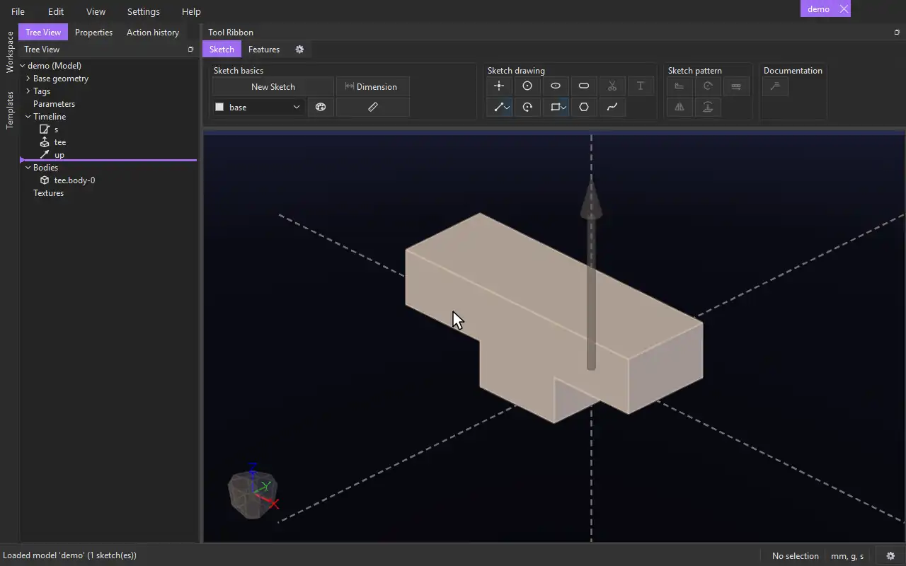

# Overhang

{.tool-demo}

Finds the faces of a feature that overhang the print direction and chamfers their edges, so the part prints without supports.

**Where:** 3D Prints bag (hidden until you add it to a tab) · **Shortcut:** none (available from the command palette, Ctrl+Shift+P)

## How to use
1. The **3D Prints** bag isn't on the ribbon at first: click the gear tab at the end of the ribbon to open the Tool Ribbon Editor, and drag **3D Prints** onto a tab.
2. Make a **Vector** pointing the way the part is printed (up, away from the print bed), if the model has none yet.
3. Click **Overhang**. Any sketch being edited is closed. When the model has exactly one vector, it is already in the **Print direction** box.
4. Click a face the feature made (or the feature in the tree) to put it in the **Feature** box.
5. The chamfers appear as you change the form, the faces they come from highlighted, with what was found below the boxes.
6. Click **Create** (or press Ctrl+Enter). **Cancel** or Escape takes the preview away.

## Options
- **Overhang angle** — what counts as an overhang, in degrees from vertical: a vertical wall is 0, a flat ceiling 90. A face facing down past this angle (45 by default) is an overhang. In a model with a `print::max_overhang_angle` parameter (one made from the 3D Print master file), a new Overhang's angle starts as that parameter.
- **Lock** — locked, the chamfers slope at the overhang angle and **Chamfer angle** is grayed out. Unlock it to type a different chamfer angle, measured from the print direction.
- **Print direction** — a vector: the way up while printing. Select it and press Delete to choose another.
- **Feature** — the feature whose faces are checked. Only the faces that feature made count; for a custom feature, the faces it made (a face it made picks the custom feature).
- **Add material** (the default) — inside corners under an overhang get a wedge of material.
- **Subtract material** — outside edges of an overhang are cut back.
- **Both** — material is added first, as with Add material. Only if some of an overhang is still left after that is it cut, with the one smallest chamfer that removes what is left (on each face still overhanging). If no single chamfer can remove it, that face's outside edges are cut as with Subtract material.
- **Ignore Failures** — off by default: if a chamfer can't be made at an edge, the feature fails and says which edge. Tick it to skip such edges and keep the rest.

## Tips
- The lowest faces that face straight down are the print bed and are never chamfered.
- Each chamfer is as big as it can be: it removes the overhang completely, or stops where the face next to it runs out. With **Both**, the cuts are only as big as it takes to remove the overhang the added material left.
- A curved face counts if any part of it overhangs.
- Overhang is a live feature: change the model before it and the chamfers follow.
- To change it later, right-click it in the tree and choose **Edit Feature**.

## See also
- [Chamfer](chamfer.md) — bevel edges you pick yourself.
- [Vector](vector.md) — make the print direction.

[← 3D Prints](../bags/3d_prints.md) · [All documentation](../index.md)
