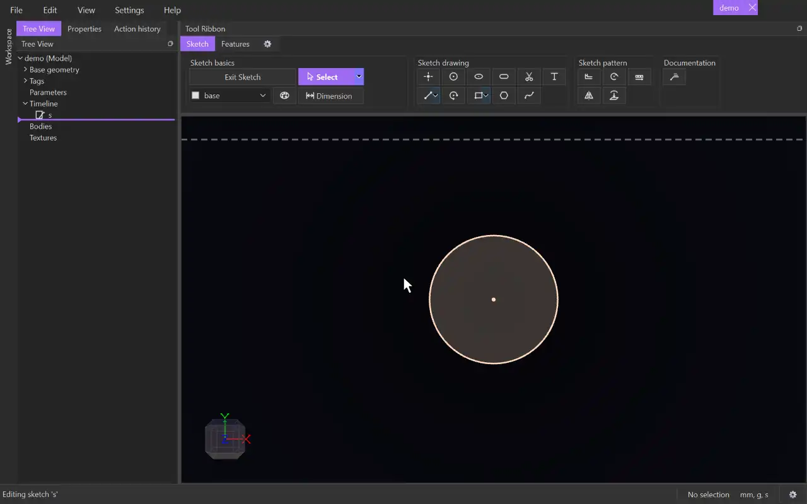

# Pattern

{.tool-demo}

Repeats sketch geometry: along a direction (add a second direction for a grid), or in rings around a centre with **Circular Pattern**.

**Where:** Sketch tab › Sketch pattern · **Shortcut:** Alt+P (while editing a sketch)

## How to use
1. Edit a sketch. Optionally select the geometry to repeat first.
2. Click **Pattern**. The Properties panel shows the Pattern form.
3. Choose the **Kind**: Pattern (along a direction) or Circular Pattern.
4. With the **Direction** box (or **Centre / axis** box) active, click the reference in the view.
5. Click the **Entities** box, then click the items to repeat. Clicking an item again removes it. The form does not move on by itself, so click the box first.
6. Set the counts and spacing. A preview shows where the copies will go.
7. Click **Create** (or press Ctrl+Enter). **Cancel** or Escape closes the form.

## Options
- **Kind** — Pattern or Circular Pattern.
- **Copy Entities** — ticked (the default) makes ordinary copies held by constraints. Unticked makes a Pattern item whose copies are derived and follow the originals.
- **Direction** — a sketch line, a model axis or a straight body edge to repeat along.
- **Centre / axis** (circular) — a point, or an axis perpendicular to the sketch.
- **Entities** — points, lines, arcs and circles. Clicking a sketch surface adds its outline. Sketches on the same plane can be added from the Model tab.
- **Copies** / **Spacing** — how many instances in total, the original included, and how far apart they are.
- **Direction 2**, **Copies 2**, **Spacing 2** — optional. The whole row repeats along a second direction to make a grid.
- **Initial Item Count** (circular) — how many items the first ring holds.
- **Angle** / **Spacing** (circular) — the angle each ring covers, or the degrees between items. A filled-in Spacing overrides the Angle.
- **Rings** / **Ring spacing** — how many rings, and how much further out each one sits.
- **Items per ring** — how many items each ring holds, e.g. `count + 2 * n`. The **Rings hold** line shows the result.

## Tips
- Every box accepts an expression. `n` (the index along the direction, or the ring number, from 0) and `count` can be used in every box except Copies, Initial Item Count and Rings. For example, a Ring spacing of `10 * n` spreads the rings out.
- A red message explains what is missing or wrong, for example "the items sit on the centre, so the rings have nowhere to go". **Create** waits until it is fixed.
- Only an unticked (derived) Pattern can be edited later. Right-click it in the Model tab and choose **Edit Pattern**, or use **Edit pattern** in the Properties panel. Kind and Copy Entities are fixed while editing.
- The form remembers the kind and values you last used.

## See also
- [Rotate](rotate.md) — a simple set of copies around a centre.
- [Mirror](mirror.md) — copy across a line.
- [Offset](offset.md) — copies a set distance away.

[← Sketch pattern](../bags/sketch_pattern.md) · [All documentation](../index.md)
