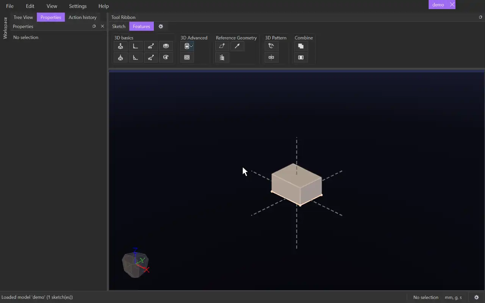

# Plane

{.tool-demo}

Creates a custom reference plane from existing geometry. You can then start sketches on it. The plane remembers what it was built from and moves with that geometry when the model changes.

**Where:** Features tab › Reference Geometry · **Shortcut:** none

## How to use
1. Optionally select the geometry first. Lines, points, planes, sketch surfaces and body faces you selected become the first picks.
2. Click **Plane**. The **Picks** box is active, so click items in the 3D view to add them. Click an item again to remove it.
3. Watch the **Needs** line. It says what is still missing, or why the picks don't make a plane.
4. Once the picks define a plane, a ghost preview appears. Fill in **Offset**, **Angle** or the check boxes if they apply.
5. Click **Create** (or press Ctrl+Enter). Escape or **Cancel** leaves without a plane.

## Options
- **Picks** — any of these combinations:
  - two coplanar lines (parallel or crossing)
  - three points
  - a line and a point
  - a plane, flat face or sketch surface on its own (with an offset)
  - a plane and a point (parallel to the plane, through the point)
  - a plane and a line lying in it (turned about the line)
  - two planes (halfway between them, or bisecting the angle where they cross)
  - a plane and a curved face (parallel to the plane, touching the face)
- **Perpendicular to the line** — for a line and a point only. Off, the plane contains both. On, it stands across the line, through the point.
- **Flip (touch the other side)** — for a plane and a curved face. It starts on the side of the face you clicked; tick it to touch the opposite side.
- **Offset** — enabled when the plane is offset from a single plane or surface. The distance along that source's normal; negative goes the other way. It accepts units and parameters, e.g. `10mm` or `sizes::gap`.
- **Angle** — enabled for a plane and a line in it. Degrees to turn the plane about the line.

## Tips
- To sketch on a cylinder for a [Wrap](wrap.md), pick a base plane and the cylinder's face. The new plane is parallel to the base plane and tangent to the cylinder. A face that can't touch such a plane is refused with a message.
- Planes are listed under **Features** in the tree. Right-click a plane for **New Sketch** (which starts a sketch on it straight away), **Show** / **Hide**, or **Delete**.
- Deleting a plane also deletes the sketches on it. The confirmation lists everything that goes with it.
- Selecting a plane shows what it was built from in the Properties panel.
- A plane built on an infinite line is sized from the current view when you create it. Its size is only visual.
- The form reopens with the offset, angle and check boxes you used last.

## See also
- [Vector](vector.md) — a direction instead of a plane
- [Helix](helix.md) — the other reference curve in this bag
- [Mirror](mirror_feature.md) — mirror bodies across a plane

[← Reference Geometry](../bags/reference_geometry.md) · [All documentation](../index.md)
