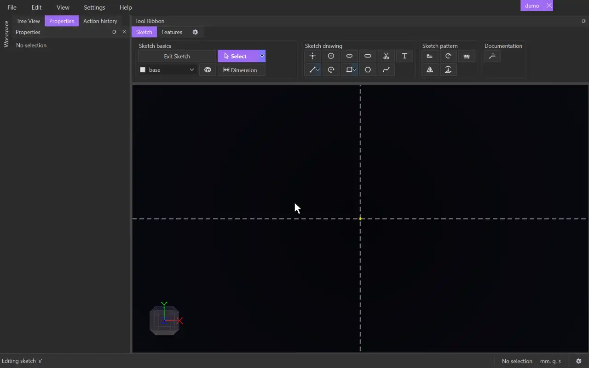

# Point

{.tool-demo}

Places single points in the sketch. Points are useful as references for dimensions, as centres, or as anchors for other geometry.

**Where:** Sketch tab › Sketch drawing · **Shortcut:** P

## How to use
1. Click **Point**. If you aren't in a sketch yet, click a plane or flat face first to start one.
2. Click in the view to place a point.
3. Keep clicking to place more. The tool stays active.
4. Press Escape to return to [Select](select.md).

## Tips
- The cursor snaps to nearby geometry. A point placed on another point is joined to it with a coincident constraint. A point placed on a line, arc, circle or spline is constrained to lie on it.
- Rest the cursor near a point or a line for a moment and dashed guides appear. They line up with that point horizontally or vertically, or extend the line past its end. A point placed on a guide is constrained to it.
- With the sketch grid on, points land on the grid when nothing else catches the cursor. The grid doesn't add any constraint.
- New points go on the tag chosen in the [Tag selector](tag_selector.md).
- Drag a point later with [Select](select.md). Use [Dimension](dimension.md) with two points to fix the distance between them.

## See also
- [Line](line.md) — connect points with straight segments
- [Dimension](dimension.md) — measure from point to point or from a point to a line
- [Select](select.md) — move points and add constraints in the Properties panel

[← Sketch drawing](../bags/sketch_drawing.md) · [All documentation](../index.md)
