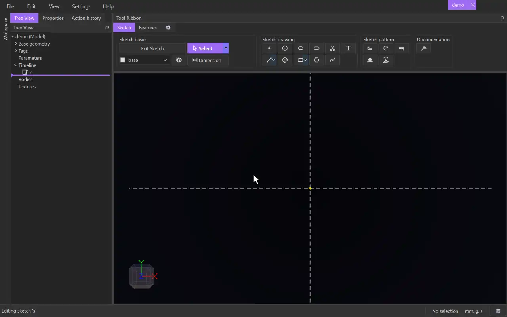

# Polygon

{.tool-demo}

Draws a regular polygon, such as a hexagon, from its centre and one corner. You set the number of sides in the Properties panel.

**Where:** Sketch tab › Sketch drawing · **Shortcut:** G

## How to use
1. Click **Polygon**. If you aren't in a sketch yet, click a plane or flat face first to start one.
2. In the Properties panel, set **Sides**.
3. Click to place the centre.
4. Move the cursor. A preview shows the polygon with one corner at the cursor.
5. Click to place that corner. The tool stays active for the next polygon.

## Options
- **Sides** — how many edges the polygon has, from 3 to 64. It starts at 6. The number applies to the polygons you draw next, not to ones already drawn.

## Tips
- Besides its edges, the polygon gets a circle on the **construction** tag that touches the middle of every edge. Each edge is tangent to that circle.
- The edges are held as one pattern turned around the centre, so they stay equal. Drag a corner with [Select](select.md) to turn and resize the whole polygon. Drag the centre to move it.
- To size it, [Dimension](dimension.md) the construction circle's diameter (across the flats) or one edge's length.
- The click must be away from the centre. A click on the centre is ignored with a message.
- Escape after placing the centre cancels the polygon and removes the centre point, unless something else already uses it.
- The closed polygon makes a 2D surface you can extrude, for example into a hex nut.

## See also
- [Rectangle](rectangle.md) — four sides with independent width and height
- [Circle](circle.md) — the shape a polygon approaches with many sides
- [Pattern](pattern.md) — repeat any geometry around a centre

[← Sketch drawing](../bags/sketch_drawing.md) · [All documentation](../index.md)
