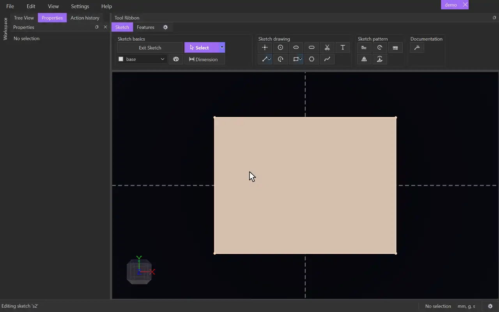

# Project

{.tool-demo}

Brings geometry from outside the sketch onto its plane: entities of other sketches, body edges and whole body faces. The projections stay linked and update when their source changes.

**Where:** Sketch tab › Sketch pattern · **Shortcut:** J (while editing a sketch)

## How to use
1. Edit the sketch you want to project into.
2. If you already selected the items to project, click **Project**. When every item can be projected, it happens straight away with no form.
3. Otherwise the Properties panel shows the Project form with the **Entities** box active. Click the items to project. Clicking an item again removes it.
4. Click the **Project** button (or press Ctrl+Enter). **Cancel** or Escape closes the form.

## Options
- **Entities** — the items to project. Select a row and press Delete to remove it. A row in red can't be projected: hover over it to see why. The **Project** button stays disabled until every red row is removed.

## Tips
- You can pick:
  - points, lines, arcs, circles and ellipses of other sketches
  - another sketch's surface, which adds the curves around it
  - body edges
  - body faces, flat or curved
- Projecting a **face** puts its whole outline in the sketch as closed loops, holes included, so the sketch gets a surface you can extrude. A face also holds up better than separate edges when the body is rebuilt later.
- A face's outline keeps the shape of its edges: a round edge comes in as one exact circle or arc, straight edges as lines, other curves as splines. (A model on the mesh engine gets short line segments instead.)
- Items from the sketch being edited can't be projected ("you cannot select items from within the same sketch"). Neither can a projection: pick its source.
- If an edit takes away the edge or face a projection follows, the projection stays where it was, drawn in the theme's broken colour (red), and the sketch turns red in the Model tab. Right-click the sketch › **Go to broken item** to select it and bring it into view, then pick a new edge in its Properties (**Relocate to**).
- A circle on a tilted plane becomes an ellipse. A circle or arc seen edge-on (its plane square to the sketch) becomes a line: a circle's runs a diameter through its centre, an arc's covers the stretch the arc spans.
- Projected geometry is placed, not solved, so you can't drag it. Constrain and dimension other geometry to it instead.
- A projection starts with its source's tag and follows it when the source is retagged. To give it a tag of its own, pick it in the Properties panel's **Tag** box or the ribbon's tag dropdown. Your choice is saved with the projection and the source isn't changed.
- Projections that meet at the same point are joined, so a ring of projected edges closes into a surface.
- There is no edit form. To change a projection, delete it and project again. Deleting the source also removes the projection.

## See also
- [Offset](offset.md) — offset a projected outline.
- [Extrude](extrude.md) — build on a projected face's outline.
- [Cut Extrude](cut_extrude.md) — cut through a body along a projected outline.

[← Sketch pattern](../bags/sketch_pattern.md) · [All documentation](../index.md)
