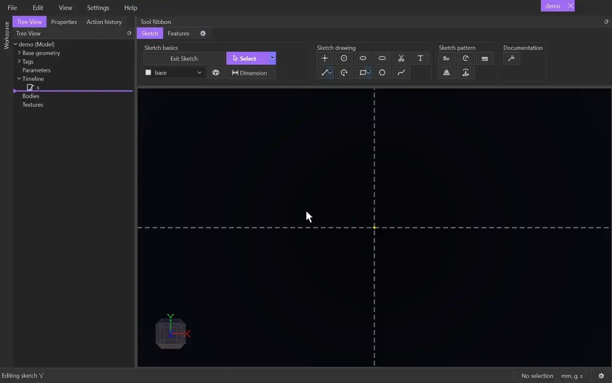

# Rectangle

{.tool-demo}

Draws a rectangle as four connected lines that stay horizontal and vertical. The **Centered Rectangle** variant draws it outward from its centre.

**Where:** Sketch tab › Sketch drawing · **Shortcut:** R

## How to use
1. Click **Rectangle**. If you aren't in a sketch yet, click a plane or flat face first to start one.
2. Click to place the first corner (or, for Centered Rectangle, the centre).
3. Move the cursor. A preview of the four sides follows it.
4. Click to place the opposite corner. The tool stays active for the next rectangle.

## Options
- **Rectangle / Centered Rectangle** — use the small arrow on the button to switch. The button shows **Centered** while that variant is chosen, and remembers it.
  - **Rectangle** — the two clicks are opposite corners.
  - **Centered Rectangle** — the first click is the centre and the second is a corner. Two diagonal lines on the **construction** tag join opposite corners, and the centre point is held at their midpoints, so it stays in the middle when you resize the rectangle.

## Tips
- The sides are ordinary lines that share their corners. The top and bottom get horizontal constraints, and the left and right get vertical ones.
- The two corners must differ in both directions. A flat rectangle is refused with a message.
- The first corner and the clicked corner snap to existing geometry like any point. The other corners are placed for you.
- Drag a corner with [Select](select.md) and the rectangle stays a rectangle.
- To size it, [Dimension](dimension.md) one horizontal side and one vertical side.
- Deleting a centred rectangle's diagonals is allowed. The centre then stops being held in the middle.
- Escape after the first click cancels the rectangle and removes that point, unless something else already uses it.
- The closed rectangle makes a 2D surface you can extrude.

## See also
- [Line](line.md) — draw the sides one at a time
- [Polygon](polygon.md) — regular shapes with any number of sides
- [Slot](slot.md) — a rectangle with rounded ends
- [Extrude](extrude.md) — turn the rectangle into a block

[← Sketch drawing](../bags/sketch_drawing.md) · [All documentation](../index.md)
