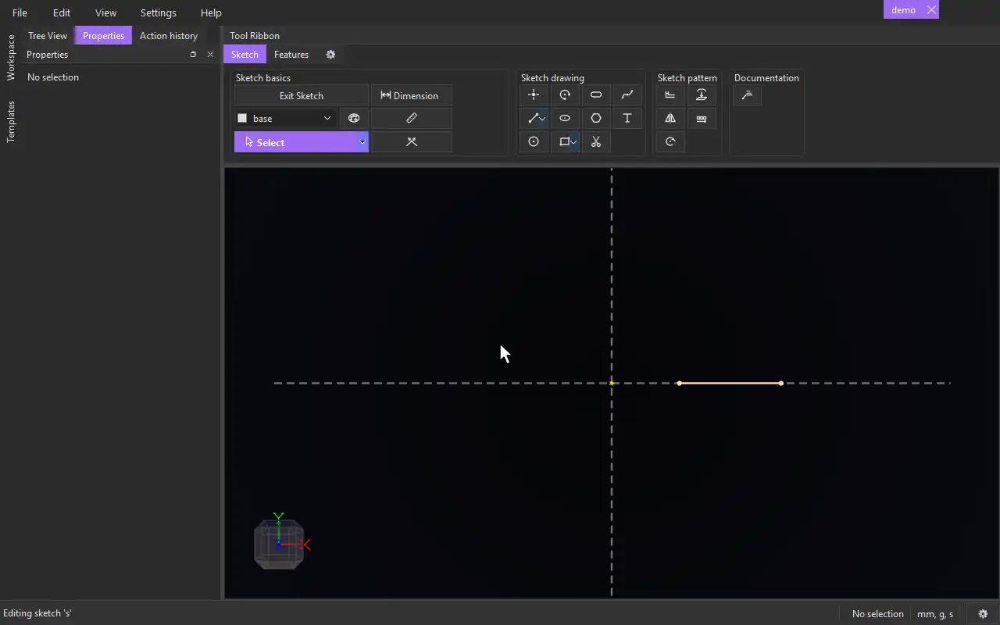

# Rotate

{.tool-demo}

Makes rotated copies of sketch geometry around a centre, spread evenly over an angle.

**Where:** Sketch tab › Sketch pattern · **Shortcut:** Alt+R (while editing a sketch)

## How to use
1. Edit a sketch. Optionally select the geometry to rotate first.
2. Click **Rotate**. The Properties panel shows the Rotate form.
3. If the **Centre / axis** box is empty it is active: click a point, or an axis that stands perpendicular to the sketch.
4. Click the **Entities** box, then click the points, lines, arcs or circles to copy. Clicking a sketch surface adds the curves around it. Clicking an item again removes it.
5. Set **Copies** and **Angle**, or type a **Spacing**.
6. Click **Create** (or press Ctrl+Enter). **Cancel** or Escape closes the form.

## Options
- **Copy Entities** — ticked (the default) makes ordinary copies held by a rotational constraint. Unticked makes a Rotate item whose copies are derived and follow the originals.
- **Centre / axis** — what to turn about: a point, or a line perpendicular to the sketch plane, such as a model axis.
- **Entities** — what to copy. Whole sketches on the same plane can be added from the Model tab.
- **Copies** — how many instances in total, the original included (2 to 999).
- **Angle** — the angle the whole set covers, in degrees (360 by default). The step between copies is the angle divided by the number of copies.
- **Spacing** — degrees between copies. Leave it blank to work it out from the angle. When filled in, it overrides the angle.

## Tips
- The step is the angle divided by the number of copies. For example, 4 copies over 360 gives a copy every 90°, but 2 copies over 90 gives a 45° step. To place copies a fixed number of degrees apart, use Spacing.
- The copies show as a preview while you fill in the form, and update as you change the centre, the entities, the copies, the angle or the spacing. Nothing is added until Create.
- A line that is not perpendicular to the sketch is refused as a centre with "not perpendicular to the sketch plane".
- Only an unticked (derived) Rotate can be edited later. Right-click it in the Model tab and choose **Edit Rotate**, or select it or one of its copies and use **Edit rotate** in the Properties panel. Copy Entities can't be changed while editing.
- Points you joined with a coincident constraint stay joined in every copy, so a closed outline turns as closed outlines (each gets its own surface).
- In the sketch, each copy shows one rotational constraint icon. The original, the centre and the end points of copied lines show none.
- The form remembers the copies, angle and spacing you last used.
- To rotate bodies or features in 3D, use the Rotate tool on the Features tab instead.

## See also
- [Pattern](pattern.md) — its Circular Pattern kind adds rings and changing spacing.
- [Mirror](mirror.md) — copy geometry across a line.
- [Rotate Extrude](rotate_extrude.md) — revolve a sketch into a solid.

[← Sketch pattern](../bags/sketch_pattern.md) · [All documentation](../index.md)
