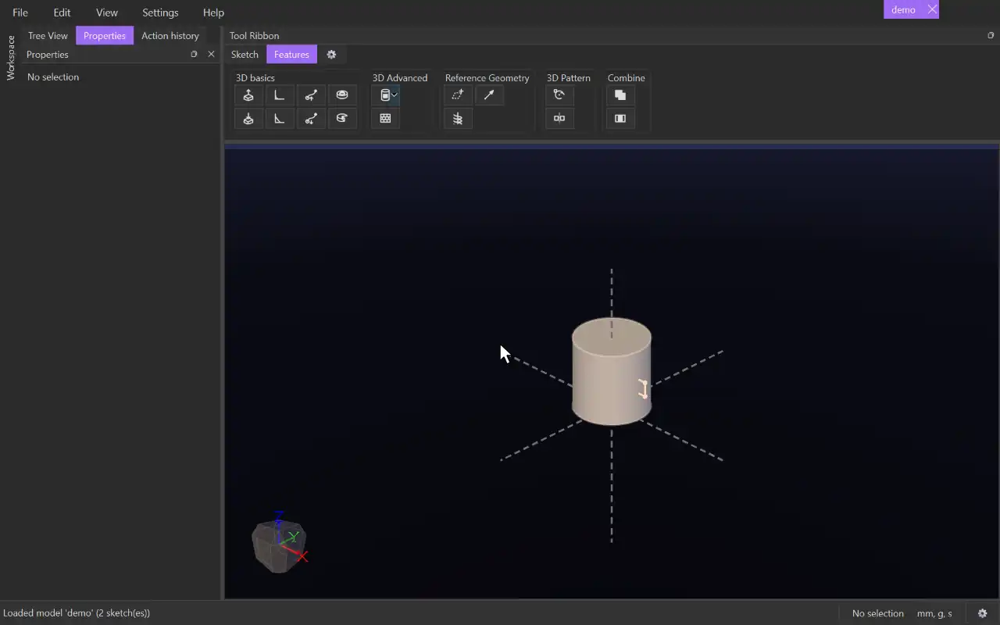

# Rotate Cut

{.tool-demo}

Cuts material out of bodies by revolving a sketch's surfaces around an axis. Use it for grooves, recesses and turned profiles.

**Where:** Features tab › 3D basics · **Shortcut:** none (available from the command palette, Ctrl+Shift+P)

## How to use
1. Draw the cutting profile in a sketch, on one side of the line you will turn it about.
2. Edit that sketch, or select it (or something in it), and click **Rotate Cut**. The sketch edit closes so you can also pick a model axis or a body edge.
3. The surfaces are filled in automatically, so the form opens on the empty **Axis** box. Click the line or axis to turn about.
4. Set the **End** angle (360 for a full turn), and the **Start** if needed.
5. Click **Create** (or press Ctrl+Enter). **Cancel** or Escape closes the form.

## Options
- **Surfaces** — the regions that do the cutting.
- **Axis** — a sketch line, a model axis or a straight body edge, lying in the profile's plane.
- **End** / **Start** — the angles in degrees (360 and 0 by default). Each is a **Distance** with **Flip**, or an **Entity** with **Offset** and **Flip offset**. An Entity can be a plane, a flat body face, a body corner or a point outside the sketch. **Through all** is not used for a revolve.
- **Symmetric (mid-plane)** — turns half the End angle each way from the sketch plane. It applies when the End is a Distance.
- **Auto select bodies** — on by default: cuts every body with the same tag as the profile's surface. Untick it to choose the bodies in the **Cut** box: click the box, then click bodies in the view to add them, and press Delete or right-click › **Delete** to take selected ones out.

## Tips
- A groove round a shaft is a small rectangle drawn on a plane through the shaft's axis, revolved 360° about that axis.
- The profile must not cross the axis. An axis outside the profile's plane is refused ("the axis is not in the profile's plane").
- If the status bar says "cut nothing (no body in its way)", the revolved shape misses every body, or the bodies have a different tag.
- After Create, the sketch is hidden.
- To change the cut later, select the body it cut and click **Edit feature** in the Properties panel.
- The form remembers the values you last used.

## See also
- [Rotate Extrude](rotate_extrude.md) — add material by revolving.
- [Cut Extrude](cut_extrude.md) — a straight cut.
- [Swept Cut](swept_cut.md) — cut along any path.

[← 3D basics](../bags/3d_basics.md) · [All documentation](../index.md)
