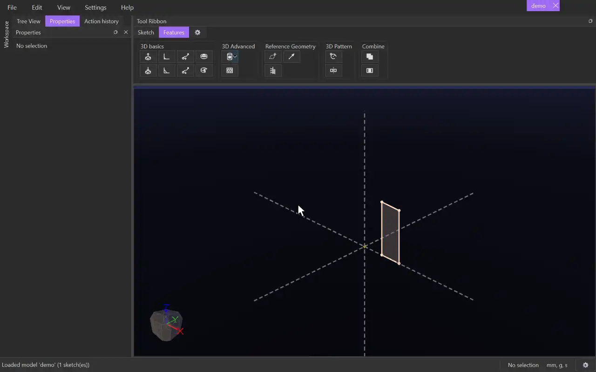

# Rotate Extrude

{.tool-demo}

Revolves a sketch's surfaces around an axis to make a solid, such as a ring, a cone or a turned part.

**Where:** Features tab › 3D basics · **Shortcut:** none (available from the command palette, Ctrl+Shift+P)

## How to use
1. Draw the profile in a sketch, on one side of the line you will turn it about.
2. Edit that sketch, or select it (or something in it), and click **Rotate Extrude**. The sketch edit closes so you can also pick a model axis or a body edge.
3. The surfaces are filled in automatically, so the form opens on the empty **Axis** box. Click the line or axis to turn about.
4. Set the **End** angle (360 for a full turn), and the **Start** if needed.
5. Click **Create** (or press Ctrl+Enter). **Cancel** or Escape closes the form.

## Options
- **Surfaces** — the regions to revolve. Click the box, then click surfaces to add or remove them.
- **Axis** — one line to turn about: a sketch line, a model axis or a straight body edge. It must lie in the profile's plane. A new pick replaces the old one.
- **End** / **Start** — the angles, in degrees. The End defaults to 360 and the Start to 0. Each one is one of:
  - **Distance** — an angle. **Flip** turns the other way.
  - **Entity** — turn until the profile reaches a plane, a flat body face, a body corner or a point outside the sketch. A point marks the half-plane through the axis and the point. **Offset** is an angle back from it, and **Flip offset** goes past it instead.
  - **Through all** — not used for a revolve. Use 360 for all the way round.
- **Symmetric (mid-plane)** — turns half the End angle each way from the sketch plane. It applies when the End is a Distance, and the Start is then ignored.
- **Auto Merge** — on by default. The result joins the touching bodies with the same tag that are shown when you click Create or Update. CADen saves which bodies those were, so hiding or showing a body later changes nothing.
  - Untick it to choose instead: tick **Merge with all** to join every touching body with the same tag, hidden or not, checked again each time the model rebuilds; or pick the bodies to merge with in the list (each one it touches joins it). Pick none for a separate body.

## Tips
- Positive angles follow the right-hand rule about the axis line. If the preview goes the long way round, press Flip.
- The profile must not cross the axis ("the profile crosses the axis"). It may touch it: a triangle with one side on the axis makes a cone.
- With an Entity end, every part of the profile stops exactly on that surface. A profile that never reaches it is refused with "the profile does not reach the entity it turns to".
- After Create, the sketch is hidden.
- To change it later, select its body and click **Edit feature** in the Properties panel.
- The form remembers the values you last used.

## See also
- [Rotate Cut](rotate_cut.md) — remove material by revolving.
- [Extrude](extrude.md) — push a sketch straight out instead.
- [Swept Extrude](swept_extrude.md) — follow any path, not just a circle.

[← 3D basics](../bags/3d_basics.md) · [All documentation](../index.md)
