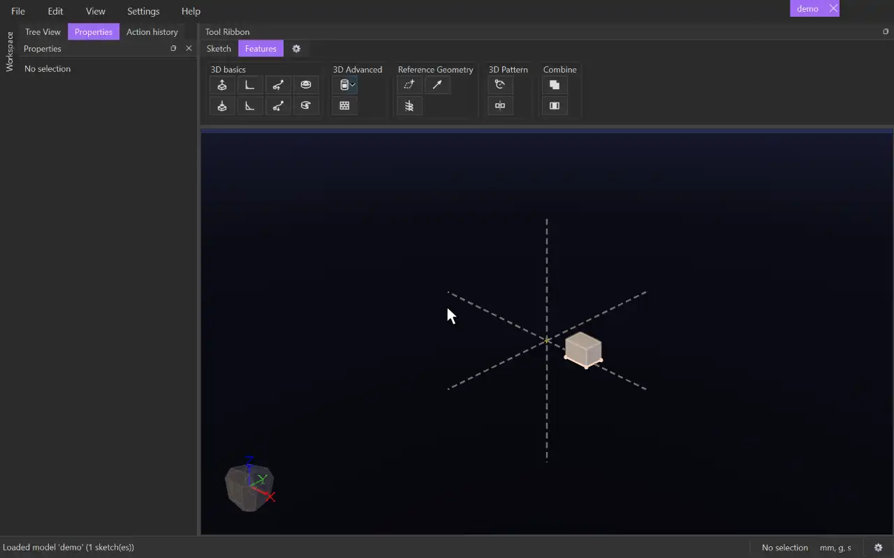

# Rotate

{.tool-demo}

Repeats 3D features or whole bodies around an axis, making a circular (rotational) pattern. Rotated copies of a raise add material, and rotated copies of a cut remove it, just as the original feature does.

**Where:** Features tab › 3D Pattern · **Shortcut:** none

## How to use
1. Optionally select the bodies first (click their faces). They become the first items.
2. Click **Rotate**. If there is no axis yet, the **Axis** box is active. Click a model axis, a sketch line or a straight body edge.
3. Click the **Items** box, then click a body's face to add the feature that made that face. Double-click a face to use the whole body instead. You can also click features or bodies in the Model tab.
4. Set **Copies**, and **Angle** or **Spacing**. A ghost preview shows the copies.
5. Click **Create** (or press Ctrl+Enter). Escape or **Cancel** leaves without changes.

## Options
- **Axis** — what the copies turn around: a model axis, any sketch line, or a straight body edge.
- **Items** — the features and bodies to repeat, applied in the order you picked them. Select a row and press Delete to remove it.
- **Copies** — the total number of instances, including the original (2 to 999).
- **Angle** — the total angle of the pattern in degrees (360 to start with). Each step is the angle divided by the copies.
- **Spacing** — degrees between instances. If you fill it in, it replaces the Angle; leave it empty to use the Angle.
- **Auto Merge** — on by default. Each copy joins the touching bodies with the same tag that are shown when you click Create or Update. CADen saves which bodies those were, so hiding or showing a body later changes nothing.
  - Untick it to choose instead: tick **Merge with all** to join every touching body with the same tag, hidden or not, checked again each time the model rebuilds; or list the bodies to merge with in the **Merge with** box (each one it touches joins it): click the box, then click bodies in the view to add them, and press Delete or right-click › **Delete** to take selected ones out. Pick none for a separate body.

## Tips
- A face click adds the *feature* that produced the face, such as an Extrude or a Cut Extrude. Each copy then behaves like that feature: a raise merges into the bodies it touches, and a cut subtracts from every body it crosses.
- Double-clicking swaps that feature for its whole body, which is then copied as a separate solid (merged as Auto Merge or your choice says).
- The pattern follows its axis and its source features. Change the original and every copy updates.
- To change it later, right-click it under **Timeline** in the Model tab and choose **Edit Feature**.
- An unsuitable axis pick is refused with a message in the status bar.
- The form reopens with the copies, angle, spacing and merge setting you used last.

## See also
- [Mirror](mirror_feature.md) — mirror features or bodies across a plane
- [Extrude](extrude.md) — make the feature to repeat
- [Helix](helix.md) — a coil around an axis instead

[← 3D Pattern](../bags/3d_pattern.md) · [All documentation](../index.md)
