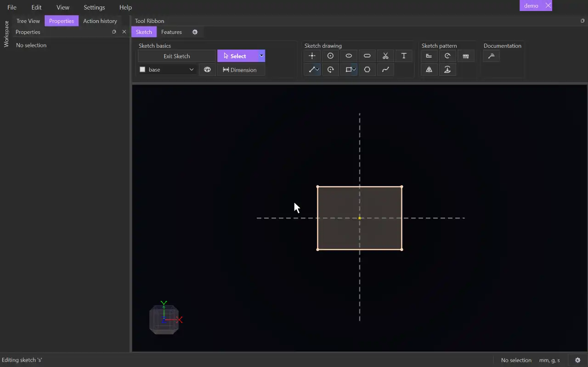

# Select

{.tool-demo}

The neutral tool: click to select items and drag to move them. CADen returns to Select whenever you leave another tool.

**Where:** Sketch tab › Sketch basics · **Shortcut:** S

## How to use
1. Click an item in the 3D view to select it. Click empty space to clear the selection.
2. Hold Shift or Ctrl while clicking to add more items.
3. Drag across empty space to select with a box:
   - **Left to right** (dashed outline) takes everything the box touches.
   - **Right to left** (solid outline) takes only items completely inside it.
4. Drag a point, line, circle or arc to move it. The constraints get the final say, so a point that is held in place won't move.
5. With items selected, the Properties panel shows their details and the constraints you can add.

## Options
- **Select / Continuous select** — use the small arrow on the button to switch variants. **Continuous select** adds the whole chain of lines and arcs joined smoothly end to end with the item you click. It works on body edges too.

## Tips
- Press Escape to clear the selection. If another tool is active, Escape first returns you to Select.
- A dragged point snaps like a newly drawn one. Release it on another point or on a line and the two are joined with a constraint. With the sketch grid on, drags move in grid steps.
- Drag a circle by its rim to change its size.
- Double-click a dimension's number to change its value. Double-click a text to open its form.
- Press Delete to delete the selection. If constraints or other geometry depend on it, a prompt lists what will go with it.
- Right-click items for **Copy**, **Cut**, **Tag** and **Style...**. Ctrl+C and Ctrl+V copy and paste sketch items.
- With a sketch open, the box only takes that sketch's geometry. Other sketches' items can be picked as partners for constraints and dimensions, but they can't be changed.
- Select works outside a sketch too, where it picks bodies, faces, edges and planes.

## See also
- [Dimension](dimension.md) — select items, then measure them
- [Tag selector](tag_selector.md) — switch tags to retag the selection
- [Trim](trim.md) — cut pieces away instead of deleting whole items

[← Sketch basics](../bags/sketch_basics.md) · [All documentation](../index.md)
