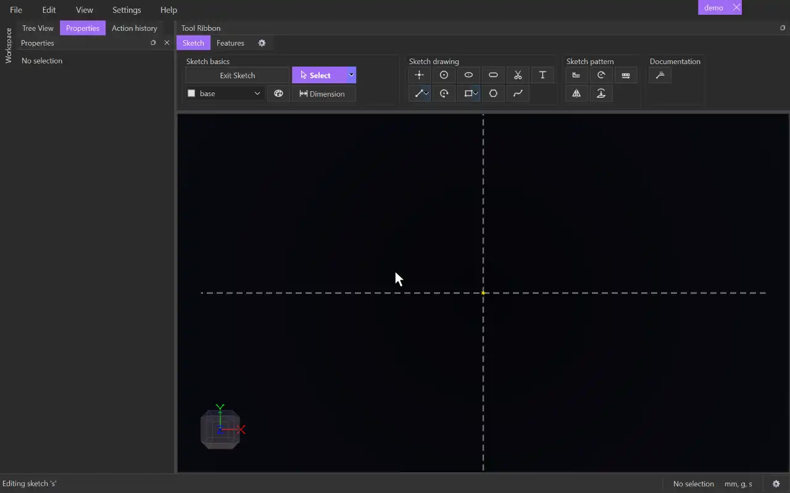

# Slot

{.tool-demo}

Draws a slot: two half-circle ends joined by two straight, parallel sides. The shape is constrained so it stays a slot when you edit it.

**Where:** Sketch tab › Sketch drawing · **Shortcut:** T

## How to use
1. Click **Slot**. If you aren't in a sketch yet, click a plane or flat face first to start one.
2. Click to place the centre of one end.
3. Click to place the centre of the other end.
4. Move the cursor to one side of the line between the centres. The distance from that line sets the radius of the ends, and a preview shows the result.
5. Click to create the slot. The tool stays active for the next one.

## Tips
- The two centres must be apart, and the third click must be beside the centre line, not on it. Otherwise the status bar explains and the click is ignored.
- The slot is made of two lines and two arcs. The sides are tangent to both arcs, the sides are equal and parallel, and the two arcs are equal.
- The radius is not dimensioned. Use [Dimension](dimension.md) on one of the arcs to set the width, and between the two centres to set the length.
- Escape part-way cancels the slot and removes the centre points it placed, unless something else already uses them. A second Escape returns to [Select](select.md).
- The centres snap to existing geometry like any point.
- A finished slot makes a 2D surface you can extrude or cut.
- Inside a sketch, T also opens the tag menu (see [Tag selector](tag_selector.md)). Rebind one of them in **Keybindings** if you only want one to happen.

## See also
- [Arc](arc.md) — the ends of a slot on their own
- [Rectangle](rectangle.md) — square ends instead of round ones
- [Cut Extrude](cut_extrude.md) — cut a slot through a body

[← Sketch drawing](../bags/sketch_drawing.md) · [All documentation](../index.md)
