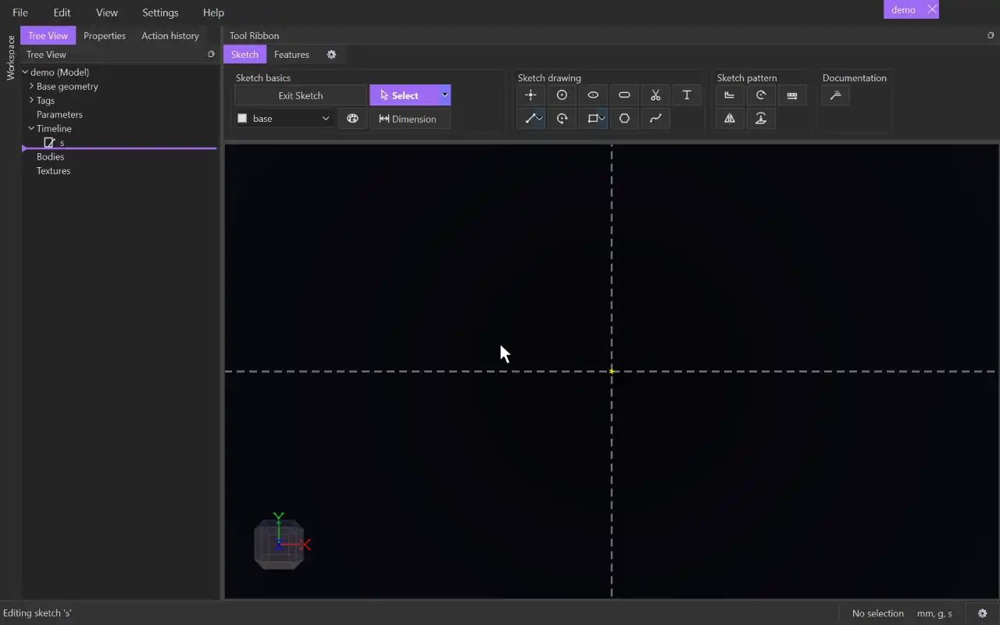

# Spline

{.tool-demo}

Draws a smooth curve that passes through every point you click. It can be left open or closed into a loop.

**Where:** Sketch tab › Sketch drawing · **Shortcut:** Alt+S

## How to use
1. Click **Spline**. If you aren't in a sketch yet, click a plane or flat face first to start one.
2. Click to place the first point.
3. Keep clicking to add points. The preview shows the curve running through the cursor.
4. To finish an open spline, press Enter, double-click or press Escape. The next click starts a new spline.
5. To close it, click the first point again (after at least three points).
6. Press Escape again to return to [Select](select.md).

## Tips
- Each point snaps like any other point. Snapping one onto existing geometry adds the matching constraint.
- The spline's points stay editable. Drag one with [Select](select.md) and the curve re-forms smoothly through it.
- Other points can snap onto the spline anywhere along it and are then held on it. Lines, arcs and circles can be made tangent to a spline.
- A click that would make a bad curve, such as a point on top of the previous one, is taken back with a message in the status bar.
- Escape after only the first click removes that point, unless something else already uses it. A spline that already has points stays as drawn.
- A closed spline makes a 2D surface you can extrude. An open spline can close a loop together with other curves.
- [Trim](trim.md) cuts splines like lines, and a spline can be a path for [Text](text.md).
- Splines go on the tag chosen in the [Tag selector](tag_selector.md).

## See also
- [Line](line.md) — straight segments, or a Polyline of many
- [Arc](arc.md) — a curve of constant radius
- [Text](text.md) — run text along a spline

[← Sketch drawing](../bags/sketch_drawing.md) · [All documentation](../index.md)
