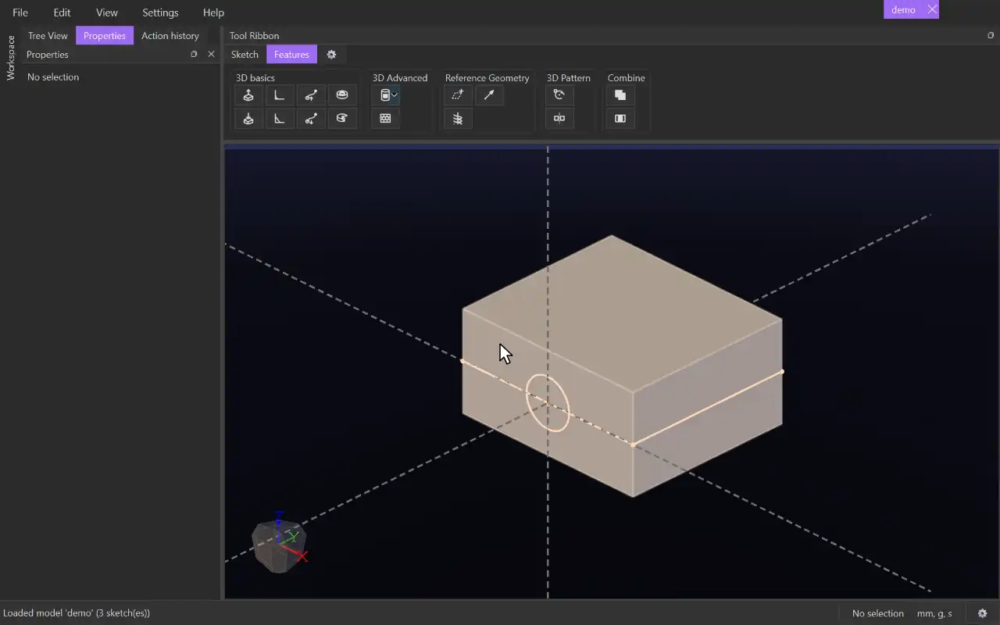

# Swept Cut

{.tool-demo}

Cuts material out of bodies by sweeping a sketch's surfaces along a path. Use it for grooves, channels and threads.

**Where:** Features tab › 3D basics · **Shortcut:** none (available from the command palette, Ctrl+Shift+P)

## How to use
1. Draw the cutting profile in one sketch and the path elsewhere: in another sketch, as body edges, or as a helix. The path must cross the profile's sketch plane.
2. Select the profile sketch (or something in it), or edit it, and click **Swept Cut**. Any sketch you were editing is closed so the path can be picked.
3. The profile's surfaces are filled in, and the form opens on the empty **Path** box.
4. Click the path in the view. With **Continuous selection** on, one click takes every piece joined to it smoothly.
5. Set the direction, scale and twist, and check the preview.
6. Click **Create** (or press Ctrl+Enter). **Cancel** or Escape closes the form.

## Options
- **Surfaces** — the profile regions that do the cutting.
- **Path** — the lines, arcs, circles, body edges or helix to follow.
- **Continuous selection** — a click also takes the pieces joined to it at a smooth join.
- **Direction** — **One way** (with **Flip** for the other end of the path) or **Both ways**.
- **Scale** — **None**, **Start & End**, or **Function of p** (`p` runs from 0 to 1 along the path).
- **Twist** — **None**, **Total angle**, **Per unit length**, or **Function of p**, in degrees.
- **Auto select bodies** — on by default: cuts every body with the same tag as the profile's surface. Untick it to choose the bodies in the **Cut** box: click the box, then click bodies in the view to add them, and press Delete or right-click › **Delete** to take selected ones out.

## Tips
- Unlike Cut Extrude, the side is not chosen for you. Use Flip or Both ways if the preview runs the wrong way.
- For a thread, sweep the profile along a helix with **Both ways**.
- If the status bar says "cut nothing", the swept shape misses every body, or the bodies have a different tag.
- Problems such as "the path is not continuous" or "the sweep runs into itself" show in red and stop Create.
- To change the cut later, right-click it in the Model tab and choose **Edit Feature**.
- The form remembers the values you last used.

## See also
- [Swept Extrude](swept_extrude.md) — add material along a path.
- [Cut Extrude](cut_extrude.md) — a straight cut.
- [Rotate Cut](rotate_cut.md) — a cut turned about an axis.

[← 3D basics](../bags/3d_basics.md) · [All documentation](../index.md)
