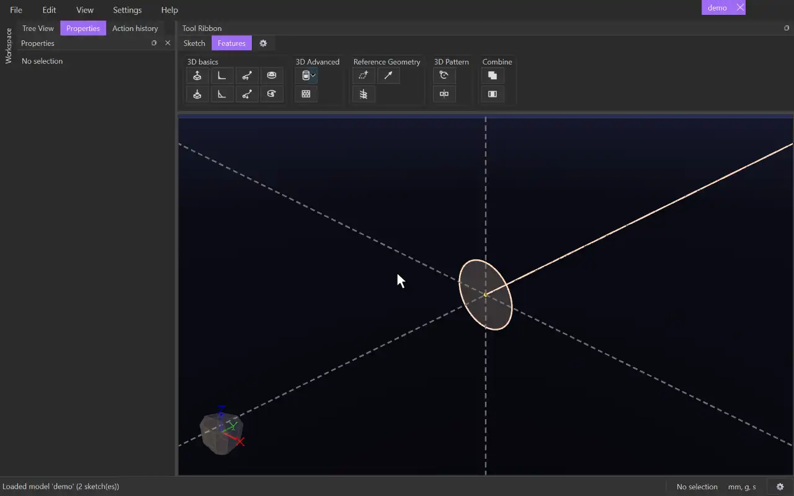

# Swept Extrude

{.tool-demo}

Sweeps a sketch's surfaces along a path to make solid bodies. Optionally the profile scales or twists along the way.

**Where:** Features tab › 3D basics · **Shortcut:** none (available from the command palette, Ctrl+Shift+P)

## How to use
1. Draw the profile in one sketch and the path elsewhere: in another sketch, as body edges, or as a helix. The path must cross the profile's sketch plane.
2. Select the profile sketch (or something in it), or edit it, and click **Swept Extrude**. Any sketch you were editing is closed so the path can be picked.
3. The profile's surfaces are filled in, and the form opens on the empty **Path** box.
4. Click the path in the view. With **Continuous selection** on, one click takes every piece joined to it smoothly.
5. Adjust direction, scale and twist while watching the preview.
6. Click **Create** (or press Ctrl+Enter). **Cancel** or Escape closes the form.

## Options
- **Surfaces** — the profile regions to sweep.
- **Path** — the lines, arcs, circles, body edges or helix to follow. Clicking an item again removes it.
- **Continuous selection** — on by default. A click also takes the pieces joined to it at a smooth join. Untick it to pick pieces one by one.
- **Direction** — **One way** runs from the profile to one end of the path, and **Flip** picks the other end. **Both ways** runs to both ends.
- **Scale** — **None**, **Start & End** (the size at the start and at the end, e.g. 1 to 0 for a point), or **Function of p**, where `p` runs from 0 to 1 along the path.
- **Twist** — **None**, **Total angle**, **Per unit length**, or **Function of p**, in degrees.
- **Auto Merge** — on by default. The result joins the touching bodies with the same tag that are shown when you click Create or Update. CADen saves which bodies those were, so hiding or showing a body later changes nothing.
  - Untick it to choose instead: tick **Merge with all** to join every touching body with the same tag, hidden or not, checked again each time the model rebuilds; or pick the bodies to merge with in the list (each one it touches joins it). Pick none for a separate body.

## Tips
- The sweep starts where the path meets the profile's plane. If the path ends at the plane, try Flip or Both ways.
- A closed path, such as a circle, goes once all the way round. A circle can't be joined to other path pieces.
- Common problems: "the path is not continuous", "the path doesn't meet the profile's sketch plane", and "the profile is wider than the path's bend".
- To change the sweep later, right-click it in the tree and choose **Edit Feature**, or select its body and click **Edit feature**.
- The form remembers the values you last used.

## See also
- [Swept Cut](swept_cut.md) — remove material along a path.
- [Extrude](extrude.md) — a straight push instead of a path.
- [Rotate Extrude](rotate_extrude.md) — turn a profile about an axis.

[← 3D basics](../bags/3d_basics.md) · [All documentation](../index.md)
