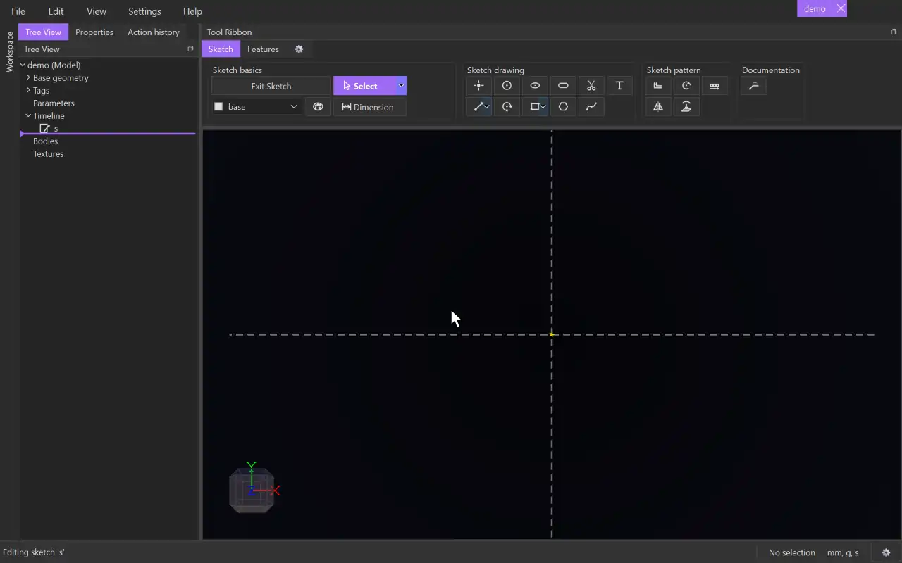

# Tag selector

{.tool-demo}

Chooses the tag that new sketch geometry is put on, such as base or construction. The palette button beside it sets a drawing style for new items on that tag.

**Where:** Sketch tab › Sketch basics · **Shortcut:** none (T opens the tag menu inside a sketch)

## How to use
1. Open the dropdown and pick a tag. Each tag is listed with its colour.
2. Draw. Every point, line, circle and other item you create from now on goes on that tag.
3. To give new items their own look, click the palette button next to the dropdown. Change the style, then close the window.

## Options
- **Tag dropdown** — the tag new geometry is drawn on. If items are selected when you switch, they move to the new tag too. Derived items and items from other sketches are left alone. The status bar says how many were retagged.
- **Palette (drawing style)** — a section for each kind of item: **Line**, **Point**, **2D surface**, **3D surface** and **Body**. Untick **Use the tag's default style** in a section to set its own values:
  - **Color**
  - **Line type** and **Line thickness** (lines)
  - **Fill** and **Pattern size** (2D surfaces)
  - **Reflectivity** (3D surfaces and bodies) — from 0% (matte) to 100%: how much of the camera's light the surface reflects, as a sheen.
  - **Pick from an item** — click it, then click an item in the view to copy that item's style.

## Tips
- The drawing style only applies to items drawn after you set it. It lasts until you change it back or restart the program. The tag's own default style is not changed.
- Inside a sketch, press T to open a tag menu at the cursor. Up/Down or T again moves through the tags, Enter picks one and Escape closes the menu without changing anything. T is also the [Slot](slot.md) tool's default key, so the same press arms Slot too. Give one of them another key in **Keybindings** if that gets in the way.
- If you draw on a tag that is hidden, the tag is shown again.
- Create or edit tags in the **Tags** group of the Config tab.
- To retag items later, right-click them in the view and use **Tag**. **Style...** on the same menu restyles them. Right-click a body in the Model tab's **Bodies** for **Style...** too.
- A tag's own **Body reflectivity** is in its tag dialog (the **Tags** group of the Config tab).

## See also
- [Select](select.md) — select items before switching tags to retag them
- [Polygon](polygon.md) and the centred [Rectangle](rectangle.md) — they add their own construction-tagged helper geometry
- [Line](line.md) — the most common thing to draw on a construction tag

[← Sketch basics](../bags/sketch_basics.md) · [All documentation](../index.md)
