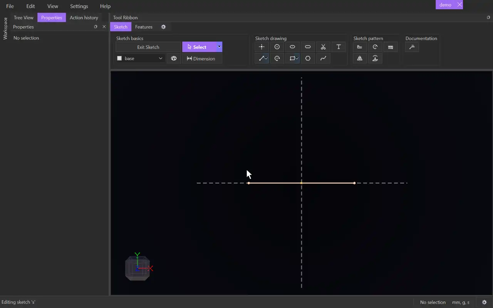

# Text

{.tool-demo}

Lays out text along a line, arc, circle, polyline or spline in the sketch. Each letter becomes a 2D surface that you can extrude, cut or wrap.

**Where:** Sketch tab › Sketch drawing · **Shortcut:** Alt+T

## How to use
1. Open a sketch and draw the path the text should follow. Text only works inside a sketch.
2. Optionally select the path, then click **Text**. The form opens in the Properties panel, with a selected path already filled in.
3. If **Path** is empty, click it, then click the path in the view.
4. Type in **Text** and adjust the options. A live preview follows every change.
5. Click **Create** (or press Ctrl+Enter). **Cancel** or Escape closes the form without adding the text.

## Options
- **Path** — the curve the text runs along. On a straight line the letters stand upright. On an arc or circle they read along the outside. A circle's text starts at the top.
- **Text** — what to write. Enter starts a new line, placed below the one before.
- **Font**, **Bold**, **Italic** — any installed font by name. If the font is missing, Times New Roman is used instead.
- **Size** — the height of a capital letter. It accepts units and parameters.
- **Letter spacing**, **Word spacing** — extra space between characters and at each space. Letter spacing may be negative.
- **Line spacing** — the distance between lines, in multiples of the size.
- **Kerning** — use the font's own spacing for letter pairs such as "AV".
- **Alignment** — Left, Center or Right along the path.
- **Mirror** — mirror-image letters, as on a stamp or a mould.
- **Flip** — put the text on the other side of the path.
- **Accept intersecting lines** — on by default, so letters with overlapping strokes fill whole. Off, any area bounded by crossing strokes is left out.

## Tips
- The text follows its path. Edit or dimension the path and the text moves with it.
- Text can run past the end of its path. It can't use an infinite line such as an axis.
- Double-click a text to edit it. While its form is open, Delete removes the text.
- Holes in letters like O and A are kept as holes.
- [Extrude](extrude.md) takes the whole text as one item. You can leave single letters out there.

## See also
- [Spline](spline.md) — draw a free-form path for text
- [Extrude](extrude.md) — raise or cut the letters
- [Wrap](wrap.md) — wrap the letters onto a curved face

[← Sketch drawing](../bags/sketch_drawing.md) · [All documentation](../index.md)
