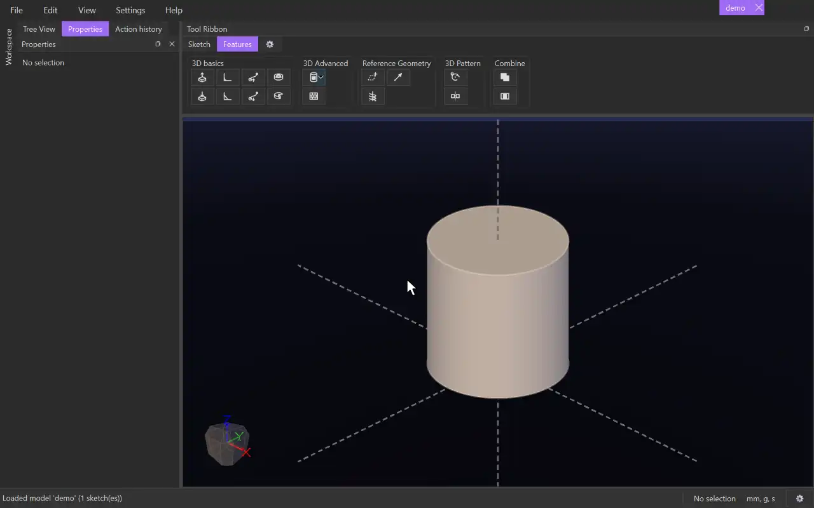

# Texture

{.tool-demo}

Covers body faces with a repeating raised or sunk pattern, such as bricks, hexagons or your own black-and-white image. Textures show in the 3D view and in STL exports, but they never change the body itself, so the face stays fully editable.

**Where:** Features tab › 3D Advanced · **Shortcut:** none

## How to use
1. Optionally select the faces first. They become the first picks.
2. Click **Texture**. The **Surfaces** box is active, so click the faces to texture (flat or curved). Click a face again to remove it.
3. Choose a **Pattern**. The swatch beside it shows how it looks.
4. Adjust **Width**, **Height**, **Depth** and the other options. A live preview appears once the form is valid.
5. Click **Create** (or press Ctrl+Enter). Escape or **Cancel** discards it.

## Options
- **Name** — optional. Left blank, a name is given for you.
- **Pattern** — Brick, Squares, Semicircles, Triangles, Cross, 4-Point Star, Decorative Cross, Hexagons, or **Image...** to choose your own PNG, JPEG or BMP. Black areas get the full depth and greys get part of it.
- **Smooth** — blurs the pattern's edges. 0% is sharp; 100% is nearly an even grey. It starts at 10%.
- **Surfaces** / **Take tangent faces too** — the faces to texture. With the box ticked (the default), faces that meet them smoothly are included too.
- **Width** / **Height** — the size of one tile, set with a slider (0.1x to 10x the default) or a number. The lock button between them keeps the two in proportion.
- **Margin (W / H)** — white space added between tiles, across and up.
- **Seamless (snap to fit)** — fits a whole number of tiles across the face (or around a cylinder) so no tile is cut at a seam. The size box pulses when a value snaps.
- **Depth** — how far black stands out (or sinks in, with Cut).
- **Cut** — sinks the pattern into the surface instead of raising it.
- **Detail** — 16 to 128 samples per tile. Finer looks crisper but is slower, and the STL uses the same mesh.
- **Tiles** — read-only: the face count, the tile size, and how many tiles fit across and up.

## Tips
- By default one tile covers a tenth of the face area. Later textures start from the settings you used last.
- Each face can carry only one texture. Picking a face that already has one is refused.
- Textures live in the **Textures** group in the tree, outside the timeline. Right-click a texture to **Edit Texture**, **Move Up** / **Move Down** (display order only) or **Delete**. Right-click the group itself to **Add Texture**.
- If an edit renames a textured face, the texture shows a missing-surface error until you edit it and pick the face again.
- **Texture Wrap** is in the drop-down on the Wrap button. As with Wrap, select a sketch (or something in it) first. It lays a sketch's surfaces onto one face as a texture relief, placed exactly as [Wrap](wrap.md) would place them. It works on flat faces too and is usually quicker and sturdier. Its form has Mode, Surfaces, Face, Depth and Flip, plus **Smooth** (0% gives straight walls; 100% softens each edge over twice the depth) and **Detail** (the finest mesh step along the outline, 0.1 mm by default). Anything past the face's edges is clipped. It appears in the Textures group and leaves the body unchanged.

## See also
- [Wrap](wrap.md) — real geometry wrapped onto a curved face

[← 3D Advanced](../bags/3d_advanced.md) · [All documentation](../index.md)
